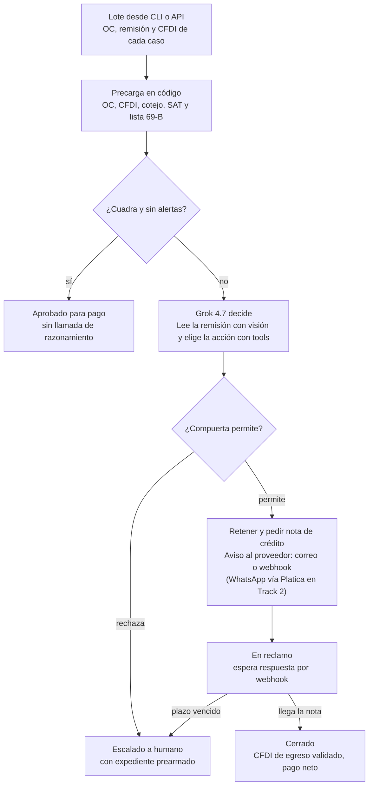

# CotejAI — Guía de implementación del agente

Oct 11, 2026 · @Pao

## Resumen ejecutivo

CotejAI se puede construir en las 4 semanas del Track 1 si se diseña como un agente con disciplina: el código calcula, Grok decide, y una compuerta de políticas valida cada acción. Como Platica es mexicana, el caso debe ser una empresa con facturas CFDI 4.0 y la integración con Platica se deja preparada desde el inicio, aunque su sandbox solo llega en el Track 2.

**Las ocho decisiones que definen la implementación**

1. **Un caso por ciclo, no un lote por prompt.** Cada OC con su remisión y su CFDI corre su propio ciclo con contexto pequeño.
2. **La factura se parsea, no se "lee".** El CFDI 4.0 es XML timbrado; Grok Vision se reserva para la remisión física.
3. **El cotejo es Python determinista.** Grok recibe las discrepancias ya calculadas en pesos y decide qué hacer.
4. **Compuerta de políticas en código** antes de cualquier pago, reclamo o retención; si no pasa, el caso se escala.
5. **La nota de crédito la emite el proveedor.** CotejAI retiene el pago, la solicita con evidencia y valida el CFDI de egreso cuando llega.
6. **Validaciones fiscales mexicanas:** estado del CFDI ante el SAT y proveedor en lista 69-B. Pocos equipos lo harán y suma en impacto y datos reales.
7. **Expediente precargado** para bajar el costo a unos USD 0,04 por caso estimado, frente a \~0,19 de un ReAct puro.
8. **Platica entra en el Track 2:** en Track 1 el notificador usa correo o un webhook propio detrás de una interfaz; con el sandbox se cambia a WhatsApp vía Platica y CotejAI se expone como servidor MCP.

**Lo primero que hay que hacer:** una llamada de prueba al gateway del reto con tool calling, imagen y `response_format`, porque de eso depende todo lo demás.

## Platica.mx y el gateway del reto

Platica es una plataforma mexicana de agentes de IA conversacionales (soporte, ventas y marketing) sobre WhatsApp, Instagram, Messenger, chat y correo. Cobra en pesos mexicanos más IVA; el plan Basic cuesta $2,499 MXN al mes ([platica.mx](https://platica.mx)). Esto define cómo debe pensarse CotejAI para el Track 2: no como un producto aislado, sino como una capacidad que un agente de Platica puede invocar.

**Cuándo entra Platica:** el sandbox de Platica solo está disponible en el Track 2. En el Track 1 lo de la tabla siguiente se diseña pero no se conecta: el notificador se escribe como interfaz y se prueba con correo o un webhook propio, para que al llegar el sandbox el cambio sea de configuración y no de arquitectura.

**Lo que Platica ya trae y CotejAI debe aprovechar**

| Capacidad de Platica | Uso en CotejAI | Fuente |
| --- | --- | --- |
| Servidores MCP externos conectados a un agente | Exponer CotejAI como servidor MCP (`auditar_lote`, `estado_caso`, `aprobar_ajuste`) para que un agente de Platica lo llame | [Servidores MCP](https://docs.platica.mx/api/herramientas/servidores-mcp) |
| APIs personalizadas (endpoint HTTP como herramienta) | Alternativa más simple al MCP: un endpoint REST de CotejAI registrado como herramienta | [APIs personalizadas](https://docs.platica.mx/api/herramientas/apis-personalizadas) |
| Mensajes y plantillas de WhatsApp | Canal para notificar al proveedor y al comprador del faltante o el reclamo | [API REST](https://docs.platica.mx/api) |
| Webhooks | Recibir la respuesta del proveedor y reabrir el caso | [Webhooks](https://docs.platica.mx/api/webhooks/introduccion) |
| Servidor MCP propio de Platica (`api.platica.mx/mcp`) | CotejAI puede usar la API de Platica como herramienta para enviar mensajes | [MCP de Platica](https://docs.platica.mx/mcp) |

**Restricciones técnicas que afectan el diseño**

- Los servidores MCP y las APIs que conecte Platica solo pueden resolver a direcciones públicas por HTTPS; localhost y redes privadas están bloqueados. CotejAI necesita estar desplegado (Railway, Render, Fly.io o un VPS) para integrarse.
- Una API personalizada tiene un timeout de 1 a 60 segundos (30 s por defecto) y recorta respuestas a 32 KB. Una auditoría de lote larga no cabe en una sola llamada: el endpoint debe aceptar el trabajo, devolver un `job_id` al instante y notificar al terminar.
- El esquema que ve el modelo de Platica se deriva de la `description` de cada variable, así que esas descripciones son parte del producto.

**El gateway del reto (`https://api.reto.pltk.mx/v1`)**

Es un espejo compatible con OpenAI hacia Grok, autenticado con la llave `RETO_KEY`. El endpoint `/v1/models` responde 401 sin llave, así que no se pudo verificar desde fuera qué expone. Antes de escribir código conviene confirmar tres cosas con una llamada de prueba:

1. Si soporta `/v1/chat/completions`, `/v1/responses` o ambos. xAI ya trata Chat Completions como legado y documenta Responses como API principal ([xAI docs](https://docs.x.ai/developers/tools/function-calling)).
2. Si acepta imágenes (`image_url` en base64) y `response_format` con `json_schema`.
3. Si devuelve el bloque `usage` completo, que es la base de la telemetría.

**Implicación de que Platica sea mexicano:** el jurado y los clientes del Track 2 operan con CFDI, SAT, pesos y WhatsApp. El caso de demostración debe ser una empresa mexicana con CFDI 4.0, no una colombiana con factura DIAN. La sección siguiente sobre el contexto fiscal detalla qué cambia.

## Grok vía API: lo que sirve para CotejAI

Grok 4.7 salió el 21 de septiembre de 2026 con 500.000 tokens de contexto, visión, tool calling y razonamiento; cuesta USD 2 por millón de tokens de entrada, 0,50 en caché y 6 de salida ([LLM Gateway](https://llmgateway.io/models/grok-4-7), [Let's Data Science](https://letsdatascience.com/news/xai-releases-grok-47-with-500k-context-43aa2021)). Arriba de 200.000 tokens de prompt la tarifa sube a 4 / 1 / 12 ([eesel](https://www.eesel.ai/blog/grok-4-7-pricing)), así que CotejAI nunca debe acercarse a ese umbral: un caso por llamada, no un lote entero.

| Capacidad | Cómo se usa en CotejAI | Detalle técnico |
| --- | --- | --- |
| Function calling | El ciclo del agente: Grok decide qué herramienta llamar | Formato compatible con OpenAI; hasta 350 herramientas por request; llamadas paralelas activas por defecto, se apagan con `parallel_tool_calls: false`; `tool_choice` admite `auto`, `required`, `none` o una función específica ([docs](https://docs.x.ai/developers/tools/function-calling)) |
| Argumentos de tools estrictos | Los argumentos siempre cumplen el JSON Schema de la herramienta | xAI indica que el flag `strict` está implícitamente activo en tools ([docs](https://docs.x.ai/developers/model-capabilities/text/structured-outputs)) |
| Structured outputs | Extracción de remisiones y veredicto final del caso | `response_format` con `json_schema`; Pydantic vía `client.beta.chat.completions.parse(..., response_format=Modelo)`; `additionalProperties` es `false` por defecto ([docs](https://docs.x.ai/developers/model-capabilities/text/structured-outputs)) |
| Visión | Leer remisiones escaneadas, sellos y firmas | Solo JPG o PNG, máximo 20 MiB por imagen, base64 o URL pública, parámetro `detail: high` ([docs](https://docs.x.ai/developers/model-capabilities/images/understanding)). Un PDF escaneado hay que convertirlo a PNG antes |
| Caché de prompt | Bajar costo del system prompt y las políticas, que se repiten en cada caso | xAI recomienda el header `x-grok-conv-id` en Chat Completions para que llamadas relacionadas caigan en el mismo servidor ([Let's Data Science](https://letsdatascience.com/news/xai-releases-grok-47-with-500k-context-43aa2021)) |

**Precauciones**

- Un agregador reporta que Grok 4.7 no garantiza esquema JSON estricto a través de su ruta ([LLM Gateway](https://llmgateway.io/models/grok-4-7)), mientras la documentación de xAI sí lo garantiza. Como el gateway del reto es otro intermediario, validar siempre la salida con Pydantic y reintentar si falla.
- Algunas palabras clave de JSON Schema solo se cumplen "a mejor esfuerzo": `if/then/else`, `not` y formatos fuera de la lista soportada. El regex de `pattern` no admite lookahead ni `\b`. Un patrón para RFC mexicano debe escribirse sin esos recursos.
- Los modelos con razonamiento tardan más; la documentación de xAI usa timeouts largos en el cliente. Configurar el cliente con un timeout amplio y el reintento con backoff.

**Modelo recomendado por tarea**

- Visión y diagnóstico: `grok-4.7` (el núcleo exigido por el reto).
- Si el gateway expone un modelo más barato (grok-4.3 o una variante rápida), usarlo para la redacción del reclamo y los casos limpios. Confirmar con el `/v1/models` del gateway.

## Contexto fiscal de México: qué cambia

En México la factura no se lee con visión: llega como un XML CFDI 4.0 timbrado, con un UUID único, y se parsea de forma exacta. Eso convierte un tercio del cotejo en código determinista y deja la visión solo para la remisión física.

**Los documentos del cotejo en México**

| Vector | Documento mexicano | Formato | Cómo lo procesa CotejAI |
| --- | --- | --- | --- |
| Lo pactado | Orden de compra | Registro en ERP o base de datos | Consulta SQL determinista |
| Lo recibido | Remisión o nota de entrega, sellada y firmada en almacén | Papel escaneado o foto (no es un CFDI) | Grok Vision con salida estructurada |
| Lo cobrado | Factura CFDI 4.0 de tipo Ingreso (I) | XML timbrado con UUID | Parser XML ([satcfdi](https://pypi.org/project/satcfdi) en Python) |
| El ajuste | Nota de crédito = CFDI de Egreso (E) | XML timbrado | La emite el proveedor; CotejAI la solicita y luego la valida |

**Validaciones fiscales que suman puntos y casi nadie hace**

1. **Estado del CFDI ante el SAT.** El SAT publica un servicio SOAP de consulta: producción en `consultaqr.facturaelectronica.sat.gob.mx/ConsultaCFDIService.svc` y pruebas en `pruebacfdiconsultaqr.cloudapp.net/ConsultaCFDIService.svc` ([phpcfdi](https://github.com/phpcfdi/sat-estado-cfdi)). Devuelve si el comprobante está Vigente o Cancelado y si es cancelable. Pagar una factura cancelada es una fuga más. Un proveedor de timbrado reporta que el servicio productivo a veces no responde ([SW](https://developers.sw.com.mx/knowledge-base/servicio-publico-de-consulta-estatus-cfdi-sat/)), así que debe ir con reintento y con un estado "no verificado" que no bloquee el lote.
2. **Proveedor en la lista 69-B (EFOS).** El SAT publica a los contribuyentes con operaciones presuntamente inexistentes y permite descargar los listados en CSV ([Alegra](https://blog.alegra.com/mexico/lista-de-efos-sat-mexico/)). Si el RFC emisor aparece como definitivo, las operaciones de sus comprobantes no producen efecto fiscal ([elconta](https://elconta.mx/?p=35927)). Esta regla escala a humano sin excepción.
3. **Coherencia interna del XML.** Que la suma de conceptos, el IVA trasladado y el total cuadren; que el RFC receptor sea el de la empresa; que la moneda y el tipo de cambio sean los de la OC.

**La nota de crédito la emite el proveedor, no CotejAI**

Una nota de crédito es un CFDI de tipo E relacionado con el UUID de la factura original mediante el tipo de relación 01 y con uso G02, devoluciones, descuentos o bonificaciones ([Facturama](https://apisandbox.facturama.mx/guias/cfdi40/nota-credito), [contadormx](https://contadormx.com/?p=25727)). Quien la timbra es quien emitió la factura. Por eso las acciones reales de CotejAI son:

- Bloquear o retener el pago de la factura en el ERP.
- Generar la **solicitud** de nota de crédito con el monto exacto, el UUID a relacionar y la evidencia (foto de la remisión, línea de la OC).
- Enviar la solicitud al proveedor por WhatsApp o correo vía Platica.
- Cuando llegue el CFDI de egreso, validar que esté relacionado con el UUID correcto, con tipo 01 y por el monto pedido, y liberar el pago neto.

Si el error es total (factura a otra razón social, precio completamente distinto), lo que procede es pedir la cancelación y sustitución, no una nota de crédito. Un CFDI con nota de crédito sin UUID relacionado pierde su naturaleza fiscal ([yo-facturo](https://yo-facturo.com/blog/como-hacer-nota-de-credito-cfdi-de-egreso-mexico/)).

**Fuente de datos reales:** la descarga masiva del SAT permite a una empresa bajar todos los XML que ha recibido de sus proveedores; satcfdi también la soporta ([GitHub](https://github.com/SAT-CFDI/python-satcfdi)). Con un cliente piloto, esa es la vía para tener cientos de facturas reales para S3 y S4.

**Colombia queda como segundo país.** Separar las reglas fiscales en un módulo `fiscal/mx.py` permite agregar `fiscal/co.py` (factura DIAN y eventos RADIAN) después sin tocar el agente. Conviene confirmar los detalles legales de ambos países con un contador antes de la demo.

## Lógica del cotejo: reglas, tolerancias y discrepancias

El cotejo se resuelve en Python con reglas fijas y Grok solo interviene en lo ambiguo. La regla base: se paga lo recibido, al precio pactado, nunca más de lo ordenado.

```latex
\text{Monto a pagar} = \sum_{\text{líneas}} \min(q_{\text{facturada}},\, q_{\text{recibida}},\, q_{\text{ordenada}}) \cdot p_{\text{OC}} \cdot (1 + \text{tasa IVA})
```

La diferencia entre el total del CFDI y ese monto es la fuga detectada, en pesos, y es el número que alimenta el reporte de S3.

**Corrección al documento maestro:** el paso 2 del ciclo dice que si las diferencias están dentro de la tolerancia se determina la causa raíz. Es al revés. Dentro de tolerancia se aprueba sin más; fuera de tolerancia se diagnostica, y solo por encima del límite de riesgo se escala a humano.

**Tolerancias de partida**

En la industria son habituales 1–3 % en precio y 2–5 % en cantidad ([Tacto](https://www.tacto.ai/en/procurement-glossary/three-way-match)); otros usan 2–3 % en precio y 5 % en cantidad ([Clyr](https://clyr.io/blog/accounts-payable/mastering-the-art-of-3-way-matching)). Para la demo, valores conservadores en `config/settings.py`, todos configurables por proveedor:

| Parámetro | Valor sugerido | Nota |
| --- | --- | --- |
| Tolerancia de precio unitario | 2 % o $1 MXN, lo que sea menor | Por línea |
| Tolerancia de cantidad | 0 unidades en piezas; 2 % en granel (kg, litros) | Las piezas se cuentan exactas |
| Diferencia por redondeo en totales | $1 MXN | Redondeos del IVA por línea |
| Límite para acción autónoma | $5,000 MXN de fuga por caso | Supuesto para la demo; lo fija el cliente |
| Confianza mínima de la extracción de la remisión | 0,85 | Debajo, revisión humana |

**Tipos de discrepancia y quién los resuelve**

| Código | Qué detecta | Lo detecta | Acción autónoma | Escala a humano si |
| --- | --- | --- | --- | --- |
| `MATCH_OK` | Todo cuadra dentro de tolerancia | Código | Aprobar para pago | Nunca |
| `QTY_SHORT` | Se facturó más de lo recibido | Código | Retener la diferencia y solicitar nota de crédito | Fuga mayor al límite |
| `QTY_OVER_PO` | Se facturó o recibió más de lo ordenado | Código | Retener excedente y avisar a compras | Siempre que sea mayor a 10 % |
| `PRICE_UP` | Precio unitario mayor al pactado | Código | Solicitar nota de crédito por la diferencia | Fuga mayor al límite |
| `UNAGREED_CHARGE` | Concepto que no está en la OC (flete, maniobras, empaque) | Grok clasifica la línea | Solicitar nota de crédito o aclaración | El contrato lo menciona de forma ambigua |
| `TAX_MISMATCH` | IVA calculado distinto al trasladado, o tasa incorrecta | Código | Solicitar sustitución del CFDI | Siempre |
| `DUPLICATE` | Mismo UUID, o mismo proveedor + folio + total | Código | Bloquear el pago | Nunca: es determinista |
| `CFDI_CANCELLED` | El SAT reporta el CFDI como cancelado | Código (SAT) | Bloquear el pago | Nunca |
| `SUPPLIER_69B` | RFC emisor en la lista 69-B | Código (lista SAT) | Congelar todo lo del proveedor | Siempre |
| `SKU_UNMAPPED` | La descripción del CFDI no se asocia a una línea de la OC | Grok propone la asociación | Aceptar si la confianza es alta | Confianza baja |
| `RECEIPT_UNREADABLE` | Remisión ilegible, sin sello o sin firma | Grok Vision | Pedir nueva foto al almacén | Segundo intento fallido |

Un caso puede tener varios códigos. Se resuelve el de mayor severidad primero, y si alguno exige escalar, todo el caso se escala con su expediente.

## Arquitectura del agente

La arquitectura recomendada es un ciclo ReAct por caso, donde Grok decide qué herramienta usar, pero con una compuerta de políticas en código que valida cada acción antes de ejecutarla. Así el agente es autónomo para la rúbrica y a la vez no puede pagar, reclamar ni escalar fuera de las reglas.



*Telemetría en cada paso: tokens, costo, latencia y decisión (tabla `llm_calls`).*

Los casos limpios se aprueban sin gastar razonamiento; todo lo que Grok propone pasa por la compuerta antes de tocar pagos o al proveedor.

**Tres principios que ordenan todo**

1. **Un caso = una unidad de trabajo.** Un caso es una OC con su remisión y su CFDI. El lote es solo una lista de casos; cada caso corre su propio ciclo con contexto pequeño. Eso mantiene cada llamada lejos del umbral de 200.000 tokens y permite paralelizar en S4.
2. **Los números los calcula el código, Grok los interpreta.** La herramienta `cotejar_caso` devuelve las discrepancias ya calculadas. Grok no puede alterarlas; decide qué hacer con ellas.
3. **Toda acción pasa por la compuerta.** Antes de ejecutar `solicitar_nota_credito` o `aprobar_pago`, una función `policy_gate()` revisa monto, códigos y límites. Si no pasa, convierte la acción en `escalar_caso` y le devuelve a Grok el motivo.

**Componentes**

| Componente | Responsabilidad | Tecnología sugerida |
| --- | --- | --- |
| Orquestador (`agent.py`) | Ciclo ReAct: arma el prompt, llama a Grok, ejecuta tools, corta a las 10 iteraciones | Python, cliente `openai` apuntando al gateway |
| Motor de cotejo (`matching/engine.py`) | Reglas y tolerancias de la sección anterior | Python puro, 100 % testeable con pytest |
| Módulo fiscal (`fiscal/mx.py`) | Parseo CFDI, estado SAT, lista 69-B | `satcfdi`, `zeep` o `httpx` para el SOAP |
| Compuerta de políticas (`policy.py`) | Decide si una acción se permite, se convierte o se escala | Python, reglas declarativas en YAML |
| Estado de casos (`state.py`) | Máquina de estados persistente e idempotente | PostgreSQL, tabla `cases` con `status` y `version` |
| Cola de trabajo (`worker.py`) | Reparte casos entre workers para la carga de S4 | `asyncio` con semáforo; Redis + RQ si hace falta |
| Telemetría (`telemetry.py`) | Tokens, costo, latencia y decisiones por paso | Tabla `llm_calls` + log JSON por línea |
| API y MCP (`api/`) | Entrada para Platica y para el CLI | FastAPI + SDK oficial de MCP en Python |

**Estados de un caso**

`RECIBIDO` → `DOCUMENTOS_LISTOS` → `COTEJADO` → uno de tres caminos: `APROBADO` (cuadra), `EN_RECLAMO` (acción autónoma enviada, se espera al proveedor) o `ESCALADO` (expediente para humano). `EN_RECLAMO` pasa a `CERRADO` cuando llega y se valida el CFDI de egreso, o a `ESCALADO` si vence el plazo. Cada transición se guarda con fecha, actor (agente o humano) y motivo: esa tabla es la bitácora auditable.

**Idempotencia:** si un worker muere a mitad de un caso, al reiniciar retoma desde el último estado guardado y no reenvía un reclamo ya enviado. Cada acción externa lleva una llave de idempotencia (`case_id + acción + versión`).

**Estructura de repositorio ajustada**

```text
cotejai-agent/
├── main.py                    # CLI: python main.py audit --batch datasets/lote_s1.json
├── config/settings.py         # Tolerancias, límites, modelo, URLs
├── config/policies.yaml       # Reglas de la compuerta
├── src/
│   ├── agent.py               # Ciclo ReAct
│   ├── prompts.py             # System prompt y plantillas
│   ├── schemas.py             # Modelos Pydantic
│   ├── policy.py              # policy_gate()
│   ├── state.py               # Máquina de estados
│   ├── telemetry.py           # Costos y bitácora
│   ├── worker.py              # Ejecución concurrente de lotes
│   ├── matching/engine.py     # Cotejo determinista
│   ├── fiscal/mx.py           # CFDI, SAT, 69-B
│   ├── tools/                 # Una función por herramienta
│   └── api/
│       ├── rest.py            # FastAPI: /audits, /cases/{id}
│       └── mcp_server.py      # Servidor MCP para Platica
├── datasets/                  # Lotes de prueba y generador sintético
├── tests/                     # pytest del motor de cotejo y la compuerta
└── docker-compose.yml         # Postgres + API + worker
```

## Herramientas: catálogo y código

El hito S2 pide tres herramientas reales; conviene agruparlas en las tres familias del documento maestro, cada una con varias funciones que Grok ve como tools independientes.

| Familia (S2) | Tool que ve Grok | Qué hace | Tipo |
| --- | --- | --- | --- |
| `db_connector` | `obtener_orden_compra` | Trae la OC con líneas, precios y condiciones | Lectura |
| `db_connector` | `cotejar_caso` | Corre el motor de cotejo y devuelve discrepancias con montos | Lectura (determinista) |
| `db_connector` | `retener_pago` / `aprobar_pago` | Cambia el estado de pago en el ERP simulado | Acción, pasa por la compuerta |
| `document_parser` | `leer_cfdi` | Parsea el XML CFDI 4.0 | Lectura (determinista) |
| `document_parser` | `leer_remision` | Extrae la remisión escaneada con Grok Vision | Lectura (LLM) |
| `document_parser` | `validar_cfdi_sat` / `verificar_proveedor_69b` | Estado del CFDI y lista 69-B | Lectura (servicio externo) |
| `notifier` | `solicitar_nota_credito` | Arma la solicitud y la envía al proveedor por Platica | Acción, pasa por la compuerta |
| `notifier` | `escalar_caso` | Crea el expediente y avisa al responsable | Acción, siempre permitida |
| (control) | `cerrar_caso` | Veredicto final estructurado; termina el ciclo | Terminal |

Usar `cerrar_caso` como herramienta terminal, en lugar de pedir un texto final, garantiza que el veredicto salga con esquema estricto, porque xAI valida los argumentos de tools contra su JSON Schema.

**1. Esquemas Pydantic (`schemas.py`)**

El dinero va siempre en `Decimal`, nunca en `float`: con `float` los totales de IVA no cuadran al centavo.

```python
from datetime import date
from decimal import Decimal
from typing import Literal
from pydantic import BaseModel, Field

class LineaRemision(BaseModel):
    sku: str | None = Field(description="Código del artículo tal como aparece; null si no se lee")
    descripcion: str
    cantidad_recibida: Decimal = Field(ge=0)
    unidad: str = Field(description="Unidad escrita en la remisión: pza, kg, caja, etc.")
    confianza: float = Field(ge=0, le=1, description="Legibilidad de esta línea, de 0 a 1")

class RemisionExtraida(BaseModel):
    folio: str | None
    fecha: date | None
    oc_referencia: str | None = Field(description="Número de orden de compra si aparece")
    lineas: list[LineaRemision]
    tiene_sello_almacen: bool
    tiene_firma_recepcion: bool
    observaciones: str | None = Field(description="Notas a mano: faltantes, daños, rechazos")

class Veredicto(BaseModel):
    case_id: str
    estado_final: Literal["APROBADO", "EN_RECLAMO", "ESCALADO"]
    codigos: list[str]
    fuga_detectada_mxn: Decimal
    monto_a_pagar_mxn: Decimal
    resumen: str = Field(description="Dos o tres frases para el área de cuentas por pagar")
```

**2. Lectura del CFDI sin LLM (`fiscal/mx.py`)**

```python
from decimal import Decimal
from lxml import etree

NS = {"cfdi": "http://www.sat.gob.mx/cfd/4",
      "tfd": "http://www.sat.gob.mx/TimbreFiscalDigital"}

def leer_cfdi(ruta_xml: str) -> dict:
    root = etree.parse(ruta_xml).getroot()
    tfd = root.find(".//tfd:TimbreFiscalDigital", NS)
    conceptos = [{
        "no_identificacion": c.get("NoIdentificacion"),
        "descripcion": c.get("Descripcion"),
        "cantidad": Decimal(c.get("Cantidad")),
        "valor_unitario": Decimal(c.get("ValorUnitario")),
        "importe": Decimal(c.get("Importe")),
        "descuento": Decimal(c.get("Descuento", "0")),
    } for c in root.findall("cfdi:Conceptos/cfdi:Concepto", NS)]
    return {
        "uuid": tfd.get("UUID").upper(),
        "tipo": root.get("TipoDeComprobante"),
        "rfc_emisor": root.find("cfdi:Emisor", NS).get("Rfc"),
        "rfc_receptor": root.find("cfdi:Receptor", NS).get("Rfc"),
        "moneda": root.get("Moneda"),
        "subtotal": Decimal(root.get("SubTotal")),
        "total": Decimal(root.get("Total")),
        "metodo_pago": root.get("MetodoPago"),
        "conceptos": conceptos,
    }
```

Para el estado ante el SAT y la lista 69-B, la librería `satcfdi` ya incluye validación de comprobantes y consulta del listado 69-B ([PyPI](https://pypi.org/project/satcfdi)); mejor usarla que armar el SOAP a mano.

**3. Remisión con visión y salida estructurada (`tools/document_parser.py`)**

```python
import base64, fitz  # PyMuPDF convierte PDF escaneado a PNG

def a_png_b64(ruta: str) -> list[str]:
    if ruta.lower().endswith(".pdf"):
        doc = fitz.open(ruta)
        return [base64.b64encode(p.get_pixmap(dpi=200).tobytes("png")).decode() for p in doc]
    return [base64.b64encode(open(ruta, "rb").read()).decode()]

def leer_remision(case_id: str, ruta: str) -> RemisionExtraida:
    imagenes = [{"type": "image_url",
                 "image_url": {"url": f"data:image/png;base64,{b}", "detail": "high"}}
                for b in a_png_b64(ruta)]
    resp = client.beta.chat.completions.parse(   # en SDK recientes: client.chat.completions.parse
        model=MODEL,
        messages=[
            {"role": "system", "content": PROMPT_EXTRACCION},
            {"role": "user", "content": imagenes + [
                {"type": "text", "text": "Extrae la remisión. No inventes valores ilegibles: usa null y baja la confianza."}]},
        ],
        response_format=RemisionExtraida,
        extra_headers={"x-grok-conv-id": case_id},
    )
    telemetry.registrar(case_id, "leer_remision", resp.usage)
    return resp.choices[0].message.parsed
```

**4. Ciclo del agente (`agent.py`)**

```python
import json, os, time, openai
from openai import OpenAI
from tenacity import retry, retry_if_exception_type, stop_after_attempt, wait_exponential_jitter

client = OpenAI(api_key=os.environ["RETO_KEY"],
                base_url=os.environ.get("BASE_URL", "https://api.reto.pltk.mx/v1"),
                timeout=300)
MODEL = os.environ.get("MODEL", "grok-4.7")
REINTENTABLES = (openai.APITimeoutError, openai.APIConnectionError,
                 openai.RateLimitError, openai.InternalServerError)

@retry(retry=retry_if_exception_type(REINTENTABLES),
       wait=wait_exponential_jitter(initial=1, max=30), stop=stop_after_attempt(5), reraise=True)
def llamar_grok(case_id: str, messages: list, paso: int):
    t0 = time.perf_counter()
    resp = client.chat.completions.create(
        model=MODEL, messages=messages, tools=TOOLS,
        tool_choice="required",          # siempre actúa vía tools; cerrar_caso termina
        parallel_tool_calls=False,       # una acción a la vez: más fácil de auditar
        extra_headers={"x-grok-conv-id": case_id},
    )
    telemetry.registrar(case_id, f"paso_{paso}", resp.usage, time.perf_counter() - t0)
    return resp.choices[0].message

def ejecutar_caso(case_id: str, max_pasos: int = 10) -> Veredicto:
    messages = [{"role": "system", "content": SYSTEM_PROMPT},
                {"role": "user", "content": f"Audita el caso {case_id}."}]
    for paso in range(max_pasos):
        msg = llamar_grok(case_id, messages, paso)
        messages.append(msg.model_dump(exclude_none=True))
        for tc in msg.tool_calls or []:
            args = json.loads(tc.function.arguments)
            if tc.function.name == "cerrar_caso":
                return state.cerrar(case_id, Veredicto(**args))
            resultado = despachar(case_id, tc.function.name, args)
            messages.append({"role": "tool", "tool_call_id": tc.id,
                             "content": json.dumps(resultado, ensure_ascii=False, default=str)})
    return state.escalar(case_id, motivo="El agente agotó sus pasos sin cerrar el caso")
```

**5. Despacho con compuerta (`policy.py`)**

```python
ACCIONES = {"solicitar_nota_credito", "aprobar_pago", "retener_pago"}
BLOQUEANTES = {"SUPPLIER_69B", "CFDI_CANCELLED", "TAX_MISMATCH"}

def policy_gate(caso, tool: str, args: dict) -> str | None:
    """Devuelve None si se permite, o el motivo del rechazo."""
    if tool not in ACCIONES:
        return None
    if BLOQUEANTES & set(caso.codigos):
        return f"Códigos {BLOQUEANTES & set(caso.codigos)} exigen escalar"
    if tool == "aprobar_pago" and Decimal(args["monto"]) > caso.monto_calculado + settings.TOL_REDONDEO:
        return "El monto a aprobar supera el calculado por el motor de cotejo"
    if tool == "solicitar_nota_credito" and Decimal(args["monto"]) > settings.LIMITE_AUTONOMO_MXN:
        return "La fuga supera el límite de acción autónoma"
    return None

def despachar(case_id: str, tool: str, args: dict) -> dict:
    caso = state.obtener(case_id)
    if motivo := policy_gate(caso, tool, args):
        telemetry.decision(case_id, tool, "RECHAZADA", motivo)
        return {"permitido": False, "motivo": motivo, "siguiente": "escalar_caso"}
    try:
        return {"ok": True, "resultado": REGISTRO[tool](case_id=case_id, **args)}
    except Exception as e:  # el error vuelve a Grok para que decida, no tumba el lote
        telemetry.error(case_id, tool, e)
        return {"ok": False, "error": type(e).__name__, "detalle": str(e)[:500]}
```

**6. Notificar al proveedor por Platica**

En el Track 1 no hay sandbox de Platica, así que `notifier` se escribe como interfaz con tres implementaciones: `NotificadorCorreo` (SMTP) y `NotificadorWebhook` (un canal propio como Slack, Discord o un endpoint de prueba) para S2, y `NotificadorPlatica` para el Track 2. Se elige con `NOTIFIER=correo|webhook|platica` en `.env`. Lo que sigue es la implementación del Track 2.

Para un mensaje dentro de una conversación abierta se usa `POST https://api.platica.mx/v1/messages` con `channelId`, `conversationId` (teléfono E.164 sin `+`) y `content`. Si la ventana de WhatsApp está cerrada (`canSendDirectMessage` en falso), hay que iniciar con una plantilla aprobada ([Platica](https://docs.platica.mx/api/mensajes/enviar-mensaje)). Como un proveedor casi nunca tendrá la ventana abierta, hay que registrar al arrancar el Track 2 una plantilla de utilidad tipo "Discrepancia en factura {{folio}}: faltan {{piezas}} piezas, solicitamos nota de crédito por {{monto}}".

La respuesta del proveedor vuelve como webhook. Platica firma con HMAC-SHA256 sobre el cuerpo crudo y manda la firma en `X-Webhook-Signature` como `sha256=<hex>` ([Platica](https://docs.platica.mx/api/webhooks/entrega-y-firmas)):

```python
import hmac, hashlib
from fastapi import FastAPI, Request, HTTPException

app = FastAPI()

@app.post("/webhooks/platica")
async def webhook_platica(request: Request):
    raw = await request.body()                    # cuerpo crudo, antes de parsear
    esperado = "sha256=" + hmac.new(settings.PLATICA_WEBHOOK_SECRET.encode(), raw, hashlib.sha256).hexdigest()
    if not hmac.compare_digest(esperado, request.headers.get("X-Webhook-Signature", "")):
        raise HTTPException(401)
    evento = json.loads(raw)
    await cola.encolar_respuesta_proveedor(evento)  # reabre el caso EN_RECLAMO
    return {"ok": True}
```

## Resiliencia, telemetría y control de costos

Con el diseño de expediente precargado, el costo estimado ronda USD 0,04 por caso en una mezcla típica; un ReAct puro sin precarga costaría unas cinco veces más. Son estimaciones con supuestos propios; las cifras reales salen de la telemetría en S3.

**Estimación de costo por caso (Grok 4.7 a USD 2 / 6 por millón)**

| Diseño | Supuesto de tokens | Costo por caso | 1.000 casos (S4) |
| --- | --- | --- | --- |
| ReAct puro: Grok pide cada dato con una tool | 7 pasos × 6.000 de entrada + visión; \~2.300 de salida por paso con razonamiento | \~USD 0,19 | \~USD 190 |
| Expediente precargado: el código reúne OC, CFDI, cotejo y SAT antes de llamar a Grok | Visión + 2 pasos × 8.000 de entrada | \~USD 0,07 | \~USD 72 |
| Mezcla: 60 % casos limpios solo con visión, 40 % con decisión | Lo anterior ponderado | \~USD 0,04 | \~USD 37 |

**Recomendación de diseño que sale de esta tabla:** el código ejecuta las lecturas deterministas (OC, CFDI, cotejo, SAT, 69-B) antes de invocar a Grok, y le entrega un expediente compacto. Grok queda con las tools de decisión y acción. Si el cotejo da `MATCH_OK` sin alertas fiscales, el caso se aprueba sin llamada de razonamiento. Así se cumple la autonomía sin gastar tokens en pasos mecánicos, que además es lo que pide el criterio de consumo productivo del reto.

**Resiliencia**

- Reintento con backoff exponencial y jitter para timeouts, errores de conexión, 429 y 5xx (código en la sección anterior). Un 400 no se reintenta: es un error de esquema y va a la bitácora.
- Validación Pydantic de toda salida de Grok. Si falla, un reintento con el error de validación en el mensaje; si vuelve a fallar, el caso se escala.
- Errores de herramientas se devuelven a Grok como resultado, no como excepción, para que decida reintentar o escalar.
- Límite de pasos por caso (10) y de tiempo por caso (3 minutos). Al vencerse, escalamiento automático.
- Circuit breaker para el servicio del SAT: tras 5 fallos seguidos, marca `sat_no_verificado` por 10 minutos en vez de bloquear el lote.
- Concurrencia acotada con un semáforo de `asyncio` (empezar con 4 casos simultáneos y ajustar según los 429 del gateway).

**Telemetría: tabla `llm_calls`**

| Campo | Ejemplo |
| --- | --- |
| `case_id`, `paso`, `tool` | `OC-2291`, `paso_2`, `leer_remision` |
| `model` | `grok-4.7` |
| `prompt_tokens`, `cached_tokens`, `completion_tokens`, `reasoning_tokens` | Del bloque `usage` de la respuesta |
| `costo_usd` | Calculado con la tarifa vigente en `settings.py` |
| `latencia_ms`, `reintentos` | Medidos en `llamar_grok` |
| `decision`, `motivo` | `RECHAZADA`, "supera el límite de acción autónoma" |

Con esa tabla, el reporte de S3 es una consulta SQL: costo medio por factura auditada contra pesos de fuga detectada, y la tasa de resolución autónoma de S4 es la proporción de casos que cerraron sin `ESCALADO`.

Verificar si el gateway reporta `cached_tokens` y `reasoning_tokens` dentro de `usage`; si no, registrar solo entrada y salida.

## Datos y evaluación

El dataset debe traer la respuesta correcta de cada caso (códigos y monto a pagar) para medir al agente con números, no con impresiones. Sin esa etiqueta no hay "evidencia con datos reales" que mostrar.

**Composición sugerida del set de evaluación (36 casos)**

| Tipo de caso | Casos | Qué prueba |
| --- | --- | --- |
| Limpio (`MATCH_OK`) | 10 | Que no reclame de más |
| Faltante parcial (`QTY_SHORT`) | 6 | Monto de nota de crédito exacto |
| Alza de precio (`PRICE_UP`) | 5 | Tolerancia de 2 % y redondeos |
| Cargo no pactado (`UNAGREED_CHARGE`) | 4 | Clasificación por Grok de fletes y maniobras |
| Duplicado (`DUPLICATE`) | 3 | Detección por UUID y por folio + total |
| IVA mal calculado (`TAX_MISMATCH`) | 3 | Escalamiento obligatorio |
| Proveedor en 69-B o CFDI cancelado | 2 | Bloqueo sin excepción |
| Remisión ilegible, sin firma o con notas a mano | 3 | Confianza baja y pedido de nueva foto |

**Cómo fabricar datos creíbles en una semana**

1. Catálogo de 3 proveedores mexicanos ficticios con RFC de formato válido y 40 SKUs.
2. Generador en Python que crea la OC, la remisión y el XML CFDI 4.0 de cada caso e inyecta la discrepancia según la tabla. El XML sintético no está timbrado ante el SAT, así que para esos casos la consulta SAT va contra un simulador; los pocos XML reales que consigan sí se consultan de verdad.
3. Remisiones con ruido real: generar el PDF, imprimirlo, sellarlo, firmarlo, tachar cantidades a mano y fotografiarlo con el celular en distintas luces. Ese ruido físico es lo que diferencia el proyecto en el criterio de datos reales.
4. Si consiguen un cliente piloto, la descarga masiva del SAT (sección fiscal) da cientos de facturas reales para S4.

**Métricas que van al reporte de S3**

| Métrica | Fórmula | Meta sugerida |
| --- | --- | --- |
| Aprobaciones indebidas | Casos con discrepancia que el agente aprobó / casos con discrepancia | 0 % (la métrica más importante) |
| Reclamos indebidos | Casos limpios que el agente reclamó / casos limpios | < 5 % |
| Exactitud del monto | Casos con monto a pagar correcto al centavo / total | > 95 % |
| Exactitud de extracción | Campos de la remisión correctos / campos etiquetados | > 90 % |
| Resolución autónoma | Casos cerrados sin escalar / total | Reportar, sin meta: escalar bien también es acertar |
| Costo por caso | Suma de `costo_usd` / casos | Reportar contra la fuga detectada |
| Retorno | Pesos de fuga detectada / costo en pesos del agente | El titular del pitch |

**Prueba de carga de S4**

1.000 unidades en 12 horas son unas 83 por hora, 1,4 por minuto: el reto es la estabilidad, no el rendimiento. Plan:

- Generar 1.000 casos con el mismo generador, en proporciones parecidas a la tabla.
- Correr el worker con concurrencia de 2 a 4 y un ritmo constante, desde un servidor (no una laptop que se duerme), con `systemd` o Docker con reinicio automático.
- Inyectar fallos a propósito durante la corrida: matar el worker, cortar la base de datos un minuto, simular 429 del gateway. Mostrar en la bitácora que el agente retomó sin duplicar acciones.
- Publicar al final un resumen: casos procesados, tasa de resolución autónoma, incidentes y su recuperación, gasto total de créditos.

## Plan de implementación semana a semana

Con dos personas, la división que menos se pisa es por capa: una persona lleva el agente y Grok (orquestador, prompts, visión, compuerta), la otra lleva datos e infraestructura (base de datos, motor de cotejo, módulo fiscal, generador, despliegue). Se juntan en las herramientas.

**Semana 1 · S1: agente corriendo**

- [ ] Llamada de prueba al gateway: listar modelos, una llamada con tool, una con imagen y una con `response_format`; documentar qué funciona
- [ ] Repo público con licencia, `.env.example`, `docker-compose.yml` con Postgres
- [ ] Esquemas Pydantic y tablas `purchase_orders`, `cases`, `llm_calls`
- [ ] Motor de cotejo con pytest para `MATCH_OK`, `QTY_SHORT` y `PRICE_UP`
- [ ] `leer_cfdi` determinista con 3 XML de ejemplo
- [ ] Ciclo ReAct mínimo con `cotejar_caso` y `cerrar_caso`; `python main.py audit --case OC-001` devuelve el veredicto en JSON y el costo en consola
- [ ] README con el problema en pesos, el diagrama y el comando de un paso

**Semana 2 · S2: herramientas reales**

- [ ] `leer_remision` con Grok Vision sobre 5 remisiones fotografiadas
- [ ] `validar_cfdi_sat` y `verificar_proveedor_69b` con circuit breaker
- [ ] Compuerta de políticas con `policies.yaml` y sus pruebas
- [ ] `solicitar_nota_credito` enviando por correo o webhook propio, detrás de la interfaz del notificador
- [ ] Reintentos con backoff y manejo de errores de tools
- [ ] Video de 2 minutos: 10 casos seguidos sin intervención, mostrando la bitácora

**Semana 3 · S3: datos y costos**

- [ ] Generador sintético y set de 36 casos etiquetados
- [ ] Remisiones físicas impresas, selladas, tachadas y fotografiadas
- [ ] Script de evaluación que compara el veredicto con la etiqueta y calcula las métricas
- [ ] Expediente precargado para bajar el costo por caso; medir antes y después
- [ ] Reporte de S3: costo medio por factura frente a pesos de fuga detectada

**Semana 4 · S4: carga**

- [ ] Despliegue en servidor con reinicio automático
- [ ] Worker concurrente con idempotencia probada
- [ ] Corrida de 12 horas con 1.000 casos e inyección de fallos
- [ ] Resumen final: resolución autónoma, incidentes, créditos gastados

**Semanas 5 a 8 · Track 2, si clasifican**

- Activar el notificador de Platica en el sandbox, registrar la plantilla de WhatsApp y exponer CotejAI como servidor MCP público y conectarlo a un agente de Platica para que el comprador pregunte por WhatsApp "¿qué facturas de esta semana tienen problemas?" y el proveedor reciba y conteste reclamos por el mismo canal.
- Unit economics en pesos: costo por factura auditada frente a un precio por factura o por suscripción, comparado con la fuga promedio que evita.

## Riesgos y preguntas abiertas

| Riesgo | Impacto | Mitigación |
| --- | --- | --- |
| El gateway no soporta visión o `response_format` | Alto: rompe la extracción de remisiones | Probarlo el día 1; plan B: extracción con tool `registrar_remision` cuyos argumentos son el esquema |
| Grok inventa cantidades en remisiones ilegibles | Alto: aprobaciones indebidas | Campo `confianza` por línea, umbral de 0,85 y regla "null antes que inventar" en el prompt |
| Servicio del SAT caído durante la demo o la carga | Medio | Circuit breaker y estado `sat_no_verificado` |
| Sin acceso a WhatsApp del proveedor por la ventana de 24 h | Medio | Plantilla de utilidad registrada al iniciar el Track 2 |
| Alcance demasiado amplio (inventarios, ERP, notas, notificaciones) | Alto: nada queda pulido | Inventarios y ajustes de merma quedan para Track 2 |
| Detalle legal fiscal mal planteado frente al jurado | Medio | Validar la sección fiscal con un contador mexicano antes de la demo |

**Preguntas para resolver con los organizadores**

- ¿El gateway expone `/v1/responses`, solo `/v1/chat/completions`, o ambos?
- ¿Qué modelos lista `/v1/models` y si hay alguno más barato para tareas simples?
- ¿Cuál es el límite de peticiones por minuto y el presupuesto de créditos del Track 1?
- ¿Cómo se entrega el sandbox de Platica al pasar al Track 2 y cuánto tarda la aprobación de plantillas de WhatsApp?

## Fuentes

- [Platica — sitio y precios](https://platica.mx)
- [Platica — API REST](https://docs.platica.mx/api)
- [Platica — Servidor MCP](https://docs.platica.mx/mcp)
- [Platica — Conectar servidores MCP a un agente](https://docs.platica.mx/api/herramientas/servidores-mcp)
- [Platica — APIs personalizadas](https://docs.platica.mx/api/herramientas/apis-personalizadas)
- [Platica — Enviar mensaje personalizado](https://docs.platica.mx/api/mensajes/enviar-mensaje)
- [Platica — Entrega y firmas de webhooks](https://docs.platica.mx/api/webhooks/entrega-y-firmas)
- [xAI — Function calling](https://docs.x.ai/developers/tools/function-calling)
- [xAI — Structured outputs](https://docs.x.ai/developers/model-capabilities/text/structured-outputs.md)
- [xAI — Image understanding](https://docs.x.ai/developers/model-capabilities/images/understanding.md)
- [Grok 4.7: lanzamiento y precio (Let's Data Science)](https://letsdatascience.com/news/xai-releases-grok-47-with-500k-context-43aa2021)
- [Grok 4.7: precios por tramo (eesel)](https://www.eesel.ai/blog/grok-4-7-pricing)
- [Grok 4.7 en LLM Gateway](https://llmgateway.io/models/grok-4-7)
- [phpcfdi/sat-estado-cfdi — servicio de consulta del SAT](https://github.com/phpcfdi/sat-estado-cfdi)
- [SW — estado del servicio de consulta SAT](https://developers.sw.com.mx/knowledge-base/servicio-publico-de-consulta-estatus-cfdi-sat/)
- [satcfdi (PyPI)](https://pypi.org/project/satcfdi)
- [Facturama — nota de crédito CFDI 4.0](https://apisandbox.facturama.mx/guias/cfdi40/nota-credito)
- [contadormx — tipo de relación y uso G02](https://contadormx.com/?p=25727)
- [yo-facturo — nota de crédito 2026](https://yo-facturo.com/blog/como-hacer-nota-de-credito-cfdi-de-egreso-mexico/)
- [Alegra — lista de EFOS](https://blog.alegra.com/mexico/lista-de-efos-sat-mexico/)
- [elconta — efectos del 69-B](https://elconta.mx/?p=35927)
- [Tacto — tolerancias en three-way match](https://www.tacto.ai/en/procurement-glossary/three-way-match)
- [Clyr — tolerancias en cuentas por pagar](https://clyr.io/blog/accounts-payable/mastering-the-art-of-3-way-matching)
