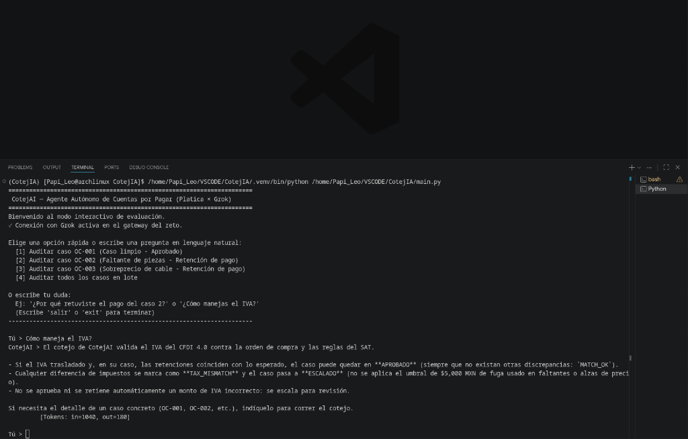

# CotejAI

**Agente autónomo de conciliación y auditoría de facturas (Three-Way Matching)** para cuentas por pagar en México. Proyecto desarrollado para el **Reto Agente 2026** (*Platica.mx × Campuslands*), Track 1 — **Entrega S1**.



---

## El problema

En las empresas mexicanas, las cuentas por pagar sufren fugas constantes de dinero porque las facturas cobradas no coinciden con lo pedido ni con lo entregado:
- Se facturan más unidades de las recibidas en almacén (**faltantes**).
- El precio unitario sube sin autorización (**sobreprecio**).
- Se cobran conceptos no pactados o se aplican tasas erróneas de impuestos del SAT.

Cotejar manualmente la **Orden de Compra (OC)**, la **Remisión de Entrega** y el **CFDI 4.0 (XML)** toma minutos por factura y los errores se traducen en pérdidas económicas directas.

**CotejAI automatiza este proceso de punta a punta:** calcula con exactitud matemática en centavos la discrepancia en pesos mexicanos (MXN), valida las reglas fiscales del SAT y decide de forma autónoma qué acción tomar: **aprobar para pago**, **retener y solicitar nota de crédito**, o **escalar a revisión humana**.

---

## Arquitectura: El Código Calcula, Grok Decide

```
                ┌──────────────────────────────────┐
                │  Caso (OC + Remisión + CFDI XML) │
                └─────────────────┬────────────────┘
                                  │
                                  ▼
                    ┌───────────────────────────┐
                    │  Motor Fiscal en Python   │  ◄── Parseo determinista de CFDI 4.0
                    │  (Aritmética en Decimal)  │  ◄── Validación de IVA 16%, 8%, 0%, retenciones
                    └─────────────┬─────────────┘
                                  │  Expediente de discrepancias calculadas
                                  ▼
                    ┌───────────────────────────┐
                    │   Grok 4.6 (xAI Gateway)  │  ◄── Razonamiento y decisión autónoma
                    └─────────────┬─────────────┘
                                  │
                    ┌─────────────┴─────────────┐
                    ▼                           ▼
        ┌───────────────────────┐   ┌───────────────────────┐
        │     APROBADO          │   │      EN_RECLAMO       │
        │ • Total CFDI liberado │   │ • Retención de fuga   │
        │ • Cero discrepancias  │   │ • Solicitud de Nota E │
        └───────────────────────┘   └───────────────────────┘
```

1. **La factura se parsea, no se alucina:** `src/cfdi.py` lee directamente el XML del CFDI 4.0 sin pasar por LLM. Extrae claves del SAT, subtotales, descuentos e impuestos por concepto (IVA general 16%, frontera norte 8%, 0%, exentos, IEPS y retenciones).
2. **Cotejo determinista:** `src/matching.py` aplica la regla fundamental: *se paga lo recibido, al precio pactado, sin exceder lo ordenado*. Grok recibe los números ya calculados en `Decimal` y no puede alterarlos.
3. **Compuerta de políticas y veredicto estricto:** El agente emite su resolución mediante la herramienta `cerrar_caso`, validada con esquemas Pydantic y sujeta a límites de acción autónoma (hasta $5,000 MXN de fuga).

---

## Casos de Prueba Incluidos

| Caso | Escenario | Discrepancia | Veredicto Esperado | Fuga Detectada |
| :--- | :--- | :--- | :--- | :---: |
| **OC-001** | Operación perfecta | `MATCH_OK` | **APROBADO** | **$0.00 MXN** |
| **OC-002** | Faltante en almacén (100 facturados vs 80 recibidos) | `QTY_SHORT` | **EN_RECLAMO** (se retiene y pide nota de crédito) | **$290.00 MXN** |
| **OC-003** | Alza de precio no autorizada ($88 vs $80 pactados) | `PRICE_UP` | **EN_RECLAMO** (se retiene la diferencia) | **$464.00 MXN** |

---

## Instalación y Configuración

### 1. Clonar el repositorio y entrar a la carpeta
```bash
git clone https://github.com/TEstebanGQ/CotejIA.git
cd CotejIA
```

### 2. Crear entorno virtual e instalar dependencias
```bash
# Con venv estándar:
python3 -m venv .venv
source .venv/bin/activate
pip install -r requirements.txt

# O de forma ultra rápida con uv:
uv venv && uv pip install -r requirements.txt
```

### 3. Configurar variables de entorno (Opcional para modo local, Requerido para Grok)
Copia la plantilla de variables:
```bash
cp .env.example .env
```
Edita `.env` con tu editor preferido y coloca tu llave:
```env
RETO_KEY=pk_tu_llave_aqui
BASE_URL=https://api.reto.pltk.mx/v1
MODEL=grok-4.6
```

---

## Instrucciones de Uso

### Modo 1: Interactivo / Zero-Friction (Recomendado para evaluadores)

No requiere memorizar comandos ni parámetros técnicos. Simplemente ejecuta:

```bash
python main.py
```

Se abrirá una consola interactiva donde puedes seleccionar casos en 1 segundo o chatear libremente:

```text
======================================================================
 CotejAI — Agente Autónomo de Cuentas por Pagar (Platica × Grok)
======================================================================
Bienvenido al modo interactivo de evaluación.
✓ Conexión con Grok activa en el gateway del reto.

Elige una opción rápida o escribe una pregunta en lenguaje natural:
  [1] Auditar caso OC-001 (Caso limpio - Aprobado)
  [2] Auditar caso OC-002 (Faltante de piezas - Retención de pago)
  [3] Auditar caso OC-003 (Sobreprecio de cable - Retención de pago)
  [4] Auditar todos los casos en lote

O escribe tu duda:
  Ej: '¿Por qué retuviste el pago del caso 2?' o '¿Cómo manejas el IVA?'
  (Escribe 'salir' o 'exit' para terminar)
----------------------------------------------------------------------
Tú > 
```

#### Ejemplos de uso interactivo:
- **Presiona `1`, `2` o `3`:** El agente audita el caso en tiempo real, desglosa los importes y muestra el veredicto oficial.
- **Haz preguntas de seguimiento:**
  ```text
  Tú > ¿Por qué retuviste el pago del caso 2?
  CotejAI > Retuve $290.00 MXN porque la factura amparaba 100 tornillos, pero la remisión de almacén solo reporta 80 recibidos. Se retuvo la diferencia y se preparó la solicitud de nota de crédito.
  ```
- **Haz consultas fiscales generales:**
  ```text
  Tú > ¿Cómo maneja el IVA?
  CotejAI > CotejAI valida el IVA del CFDI 4.0 contra la orden de compra y las reglas del SAT (16%, 8% frontera, 0% o exento). Cualquier error de cálculo o tasa no pactada se clasifica como TAX_MISMATCH y se escala a humano.
  ```

---

### Modo 2: Comandos CLI (Automatización y Lotes)

Para pruebas programáticas o integración en pipelines:

```bash
# Auditar todos los casos de datasets/ con Grok
python main.py audit --all

# Auditar un caso específico con Grok
python main.py audit --case OC-002

# Ejecutar únicamente el motor de cotejo determinista (sin conexión a Grok)
python main.py cotejo --case OC-002

# Ejecutar la suite completa de 35 pruebas unitarias
pytest
```

---

## Resultados de Telemetría (Ejecución Real con Grok 4.6)

Resultado obtenido con `python main.py audit --all`:

| Caso | Estado Final | Códigos SAT/Cotejo | Fuga Retenida | Monto a Pagar | Llamadas Grok | Tokens (In / Out) | Latencia |
| :---: | :---: | :---: | :---: | :---: | :---: | :---: | :---: |
| **OC-001** | `APROBADO` | `MATCH_OK` | $0.00 MXN | $6,090.00 MXN | 2 | 2,529 / 133 | 10.1 s |
| **OC-002** | `EN_RECLAMO` | `QTY_SHORT` | $290.00 MXN | $5,800.00 MXN | 2 | 2,565 / 154 | 11.0 s |
| **OC-003** | `EN_RECLAMO` | `PRICE_UP` | $464.00 MXN | $6,090.00 MXN | 2 | 2,571 / 162 | 12.4 s |

---

## Roadmap de Entregas (Torneo Platica MagIA)

- [x] **Semana 1 (S1) · Agente corriendo:** Flujo end-to-end con Grok 4.6, parseo de CFDI 4.0, cálculo determinista de impuestos y modo interactivo de terminal.
- [ ] **Semana 2 (S2) · Herramientas reales:** Extracción de remisiones escaneadas con Grok Vision, consulta de estado del CFDI ante el SAT (SOAP) y lista negra 69-B con circuit breaker, compuerta `policies.yaml` y despacho de notas de crédito.
- [ ] **Semana 3 (S3) · Datos y costos:** Dataset de 36+ casos etiquetados con ruido físico y reporte financiero de ROI por caso auditado.
- [ ] **Semana 4 (S4) · Semana de carga:** 1,000 casos procesados de forma desatendida durante 12 horas con persistencia SQLite WAL y control de backpressure.
- [ ] **Track 2 · Modelo de negocio:** Exposición de CotejAI como servidor MCP conectado a los canales de WhatsApp y omnicanalidad de Platica.mx.

---

## Licencia

Distribuido bajo la licencia MIT. Consulta [LICENSE](LICENSE) para más información.
