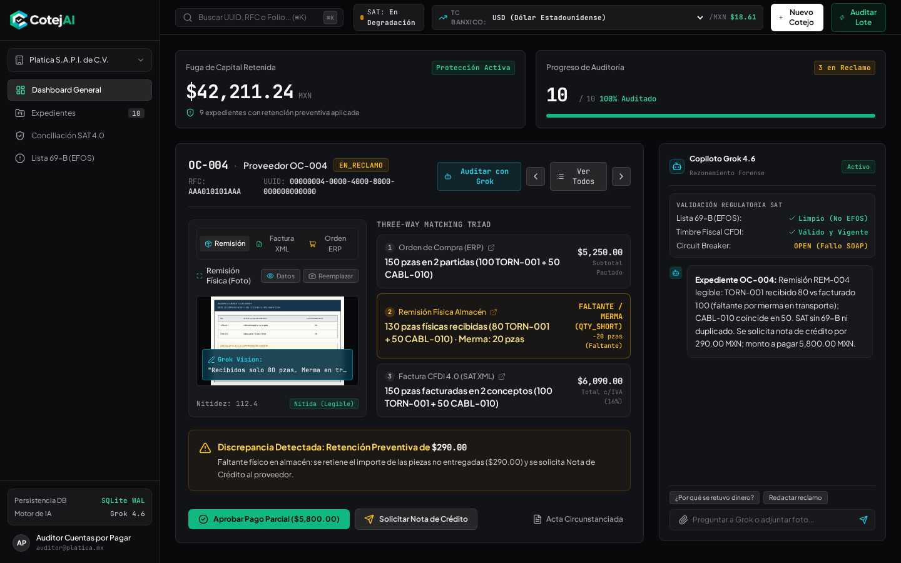
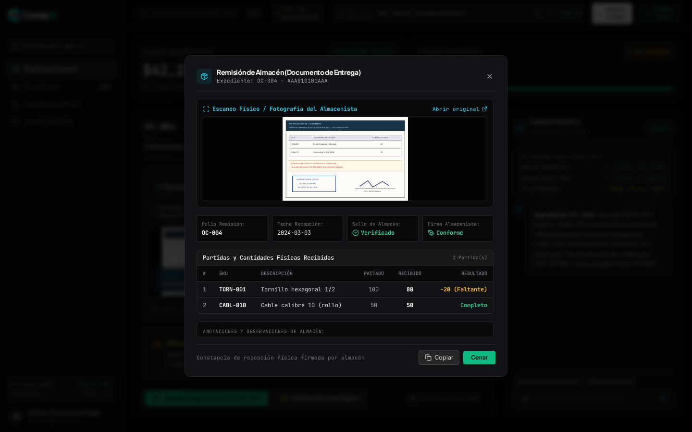
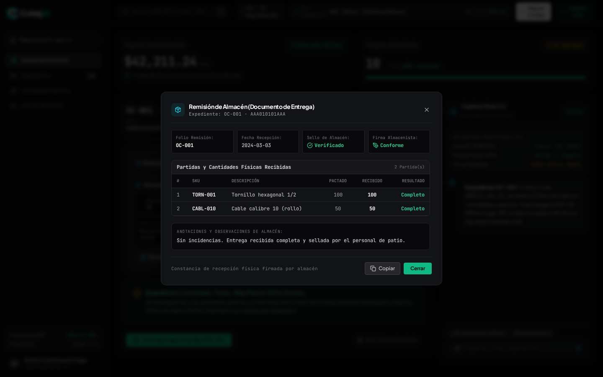
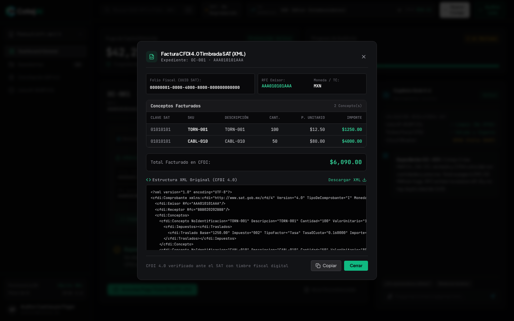
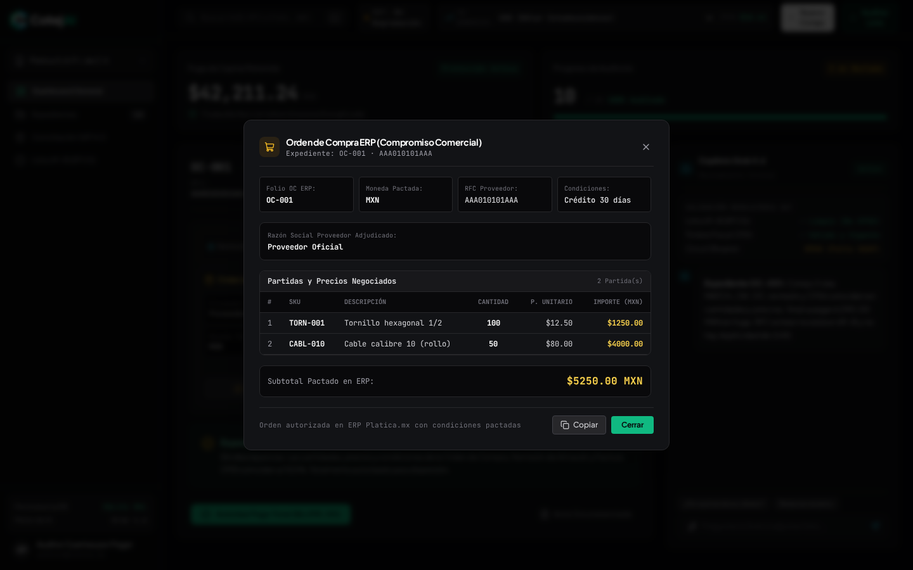
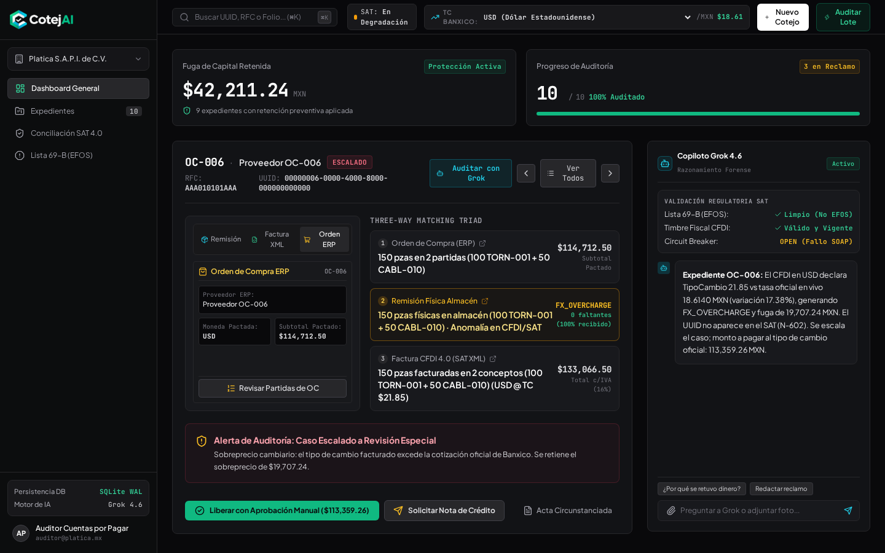
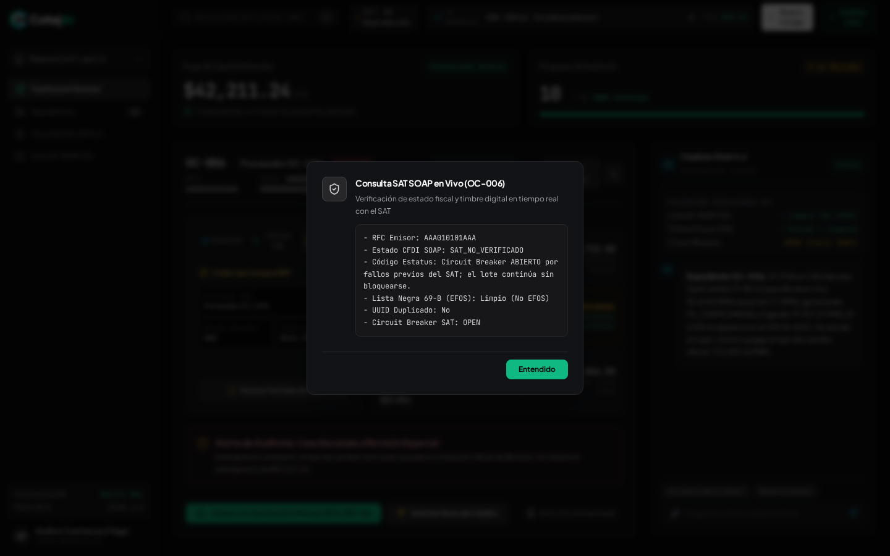
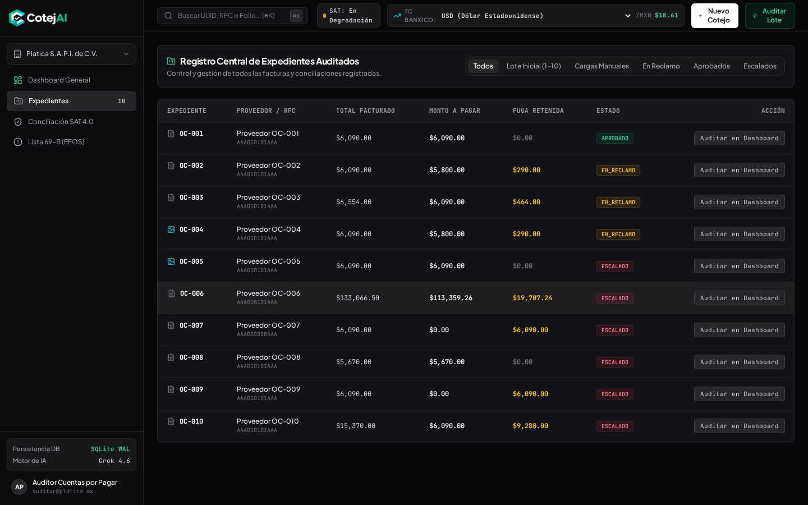

# CotejAI — Agente Autónomo de Cuentas por Pagar (Three-Way Matching)

<div align="center">
  
  <p><strong>Auditoría autónoma de facturas CFDI 4.0, remisiones físicas y órdenes de compra con Grok 4.6</strong></p>
  <p><em>Platica.mx × Campuslands · Reto Agente 2026 · Track 1 — <strong>Entrega final</strong></em></p>
  <p>
    
    
    
    
    
  </p>
</div>

---

## 🏁 Entrega final (para el jurado y el harness)

| Entregable | Dónde |
|---|---|
| Repositorio público, licencia abierta | Este repo · [`LICENSE`](LICENSE) (MIT) |
| Arranque de un comando | [`docker compose up --build`](#-arranque-en-un-comando) o `python main.py web` |
| CLI / endpoint para casos propios | [`python main.py audit --dir <carpeta>`](#-evaluar-con-casos-propios-harness) · `POST /api/v1/auditar` |
| Video de demostración (5 min) | 🔗 **[Ver en Google Drive](https://drive.google.com/file/d/1e8TJilVylbz0fz_jSWQRWsL-Nvo3ilv0/view?usp=drivesdk)** · copia en el repo: [`docs/videos/cotejai_demo_final_5min.mp4`](docs/videos/cotejai_demo_final_5min.mp4) |
| Reporte técnico (≤ 3 páginas) | [`docs/Reporte_Tecnico_Final_CotejAI.pdf`](docs/Reporte_Tecnico_Final_CotejAI.pdf) · fuente [`reports/REPORTE_TECNICO_FINAL_COTEJAI.md`](reports/REPORTE_TECNICO_FINAL_COTEJAI.md) |
| Bitácora de consumo (exportación de la consola) | [`runs/consumo_consola_reto.csv`](runs/consumo_consola_reto.csv) |
| Bitácora de la corrida de carga (1,000 tareas, 12 h) | [`runs/bitacora_s4.csv`](runs/bitacora_s4.csv) · [`.jsonl`](runs/bitacora_s4.jsonl) · auditoría contra ground truth: [`eval/analisis_bitacora_s4.md`](eval/analisis_bitacora_s4.md) |

**Sobre la bitácora de consumo:** el panel del reto (`reto.pltk.mx/panel`) no tiene botón de exportación. `runs/consumo_consola_reto.csv` transcribe sus tablas al 10 nov 2026: **3,024 peticiones a grok-4.6, 23.4 M tokens de entrada y 306 k de salida, USD 28.21** acumulados desde S1. Los costos de las bitácoras propias se calcularon a precio de lista (USD 2 por M de entrada y USD 10 por M de salida), por lo que son una cota superior: la consola cobra menos por token.

### Resultados en una línea

1,000 expedientes en 12 h 14 min con Grok 4.6 por **USD 17.49** (USD 0.037 por expediente completo). Al auditar la bitácora contra el ground truth, encontramos que el 68% de los casos se escaló en silencio por una falla del sistema y que 11 CFDI cancelados se aprobaron. Donde el cotejo sí corrió, el agente acertó en el **96.6%**. Ambas fallas están corregidas y verificadas: el motor ahora acierta **1000/1000** en S4 y **36/36** en S3, y ninguna falla se escala sin código. El detalle está en [`eval/analisis_bitacora_s4.md`](eval/analisis_bitacora_s4.md).

---

## 🚀 Arranque en un comando

**Con Docker** (API + dashboard + PostgreSQL):

```bash
docker compose up --build
```

Abre http://localhost:8000. Si existe un `.env` con `RETO_KEY`, el agente usa Grok 4.6; si no, funciona en modo determinista.

**Sin Docker** (Python 3.11+; si no hay Postgres, usa SQLite):

```bash
pip install -r requirements.txt
python main.py web
```

Para usar Grok: `cp .env.example .env` y pega tu `RETO_KEY`.

---

## 🧪 Evaluar con casos propios (harness)

### Formato de un caso

Un caso es una carpeta; un lote es una carpeta de carpetas. Hay ejemplos en [`casos/`](casos/README.md).

| Archivo | Requerido | Contenido |
|---|---|---|
| `oc.json` | sí | Orden de compra: `proveedor_rfc`, `moneda`, `lineas[]` con `sku`, `cantidad`, `precio_unitario`, `tasa_iva` |
| `cfdi.xml` | sí | CFDI 4.0 (los conceptos se cruzan por `NoIdentificacion` = `sku`) |
| `remision.json` · `remision.pdf` · `remision.png` | al menos uno | Lo recibido en almacén: JSON, PDF digital (extracción local sin red) o foto (Grok Vision) |
| `sat_estatus.json` | no | Acuse de estatus SAT, p. ej. `{"uuid": "...", "estado": "Cancelado"}` |
| `esperado.json` | no | Si existe, la salida agrega `comparacion_esperado` (estado, códigos y monto) |

### CLI

```bash
python main.py audit --dir casos                          # carpeta de casos
python main.py audit --dir casos/EJEMPLO-001              # un solo caso
python main.py audit --dir casos --modo determinista --out resultados.jsonl
docker compose run --rm app python main.py audit --dir /casos   # en Docker (monta ./casos)
```

- **stdout:** un veredicto JSON por línea. **stderr:** progreso y un resumen final (`total`, `estados`, `aciertos` contra `esperado.json`, `costo_usd`).
- `--modo auto` (por defecto) usa Grok si hay `RETO_KEY`, si no el motor determinista; también acepta `grok` o `determinista`.
- Cada corrida usa una **SQLite temporal aislada**, así que los duplicados se detectan dentro del lote y no contra corridas anteriores. Con `--persistir-bd` usa la BD del proyecto.
- Código de salida `0`, o `1` si algún caso terminó en error de sistema. Un caso nunca se pierde: el peor resultado es `ESCALADO` con `SYSTEM_ERROR` y el motivo.

Ejemplo de veredicto (una línea de stdout, aquí formateada):

```json
{"case_id": "EJEMPLO-002", "estado_final": "EN_RECLAMO", "codigos": ["PRICE_UP"],
 "monto_a_pagar_mxn": "…", "fuga_detectada_mxn": "…", "resumen": "…", "modo": "grok-4.6",
 "herramientas": ["cotejar_caso", "consultar_sat_en_vivo", "enviar_alerta_reclamo_real", "cerrar_caso"],
 "uso": {"llamadas_llm": 4, "tokens_in": 15210, "tokens_out": 402, "costo_usd": 0.0344, "latencia_s": 41.2},
 "error": null}
```

**Estados:** `APROBADO` (solo `MATCH_OK`) · `EN_RECLAMO` (solo `QTY_SHORT`/`PRICE_UP` con fuga ≤ $5,000 MXN; retiene la diferencia y pide nota de crédito) · `ESCALADO` (todo lo demás: `SUPPLIER_69B`, `CFDI_CANCELADO`, `DUPLICATE`, `FX_OVERCHARGE`, `TAX_MISMATCH`, `RECEIPT_UNREADABLE`, `SKU_UNMAPPED`, `SAT_NO_VERIFICADO`, `SYSTEM_ERROR`, o fuga > $5,000).

### HTTP

Con el servidor arriba (`python main.py web` o Docker):

```bash
curl -X POST http://localhost:8000/api/v1/auditar -H "Content-Type: application/json" -d '{
  "case_id": "MI-CASO-1",
  "oc": { "proveedor_rfc": "DIP120930T55", "moneda": "MXN", "lineas": [ ... ] },
  "cfdi_xml": "<?xml version=\"1.0\" ...>",
  "remision": { "tiene_sello_almacen": true, "tiene_firma_recepcion": true, "lineas": [ {"sku": "DISC-018", "cantidad_recibida": 160} ] },
  "modo": "auto"
}'
```

- La remisión también puede ir como `remision_pdf_base64` o `remision_png_base64`, y el acuse SAT como `sat_estatus`.
- Responde con el mismo JSON de veredicto que el CLI; si la entrada es inválida, devuelve `422` con el motivo.
- `POST /api/v1/auditar-lote` recibe `{"casos": [ ... ]}` en orden, así que detecta UUID duplicados entre ellos.
- Documentación interactiva en http://localhost:8000/docs.

### Pruebas y reproducción

```bash
python -m pytest        # 82 pruebas, ~25 s (en un clon limpio se omite 1 que requiere datasets/s4; genérelo con datasets/generate.py --s4)
```

Para reproducir la evaluación: `python main.py audit --dir datasets/s3`. El dataset S4 se regenera idéntico con `python datasets/generate.py --s4`, y después `python main.py audit --dir datasets/s4`.

---

## 📌 Tabla de Contenidos (detalle técnico por sprint)
1. [Evidencias Visuales en Tiempo Real (Capturas UI)](#-evidencias-visuales-en-tiempo-real-capturas-ui)
2. [Inspección Multidocumental (El Sistema de 3 Vías)](#-inspección-multidocumental-el-sistema-de-3-vías)
3. [Las 5 Herramientas Autónomas de CotejAI (Function Calling)](#-las-5-herramientas-autónomas-de-cotejai-function-calling)
4. [Matriz de Expedientes de Prueba (Lote S2: OC-001 a OC-010)](#-matriz-de-expedientes-de-prueba-lote-s2)
5. [Guía de Verificación Rápida para Testers](#-guía-de-verificación-rápida-para-testers)
6. [Instalación y Puesta en Marcha](#-instalación-y-puesta-en-marcha)
7. [Resultados de Telemetría e Impacto Financiero (S2)](#-resultados-de-telemetría-real-e-impacto-financiero)
8. [Sprint 4: Semana de Carga (1,000 Tareas y 12h Desatendido)](#-sprint-4-semana-de-carga-1000-tareas-y-12h-desatendido)
9. [Videos](#-videos-demo-y-grabación-de-pantalla-en-vivo)

---

## 📸 Evidencias Visuales en Tiempo Real (Capturas UI)

Todas las capturas fueron tomadas directamente en tiempo real mediante automatización con Playwright sobre la aplicación activa:

### 1. Dashboard Principal Forense
*Vista central con Bento Grid de métricas, telemetría de tokens, selector de divisas y expediente activo.*


---

### 2. Visor Multidocumental: Pestaña Remisión de Almacén
*Inspección óptica de remisión física con anotación manuscrita resaltada por Grok Vision y score de nitidez.*


---

### 3. Ficha Digital de Recepción (Casos sin Fotografía Escaneada)
*Para expedientes sin imagen física (`OC-001`, `OC-002`, `OC-003`), CotejAI presenta la constancia digital de almacén con sellos, firmas y observaciones de patio.*


---

### 4. Inspección Profunda de Factura CFDI 4.0 XML
*Modal de inspección fiscal con desglose de conceptos SAT, impuestos trasladados/retenidos, UUID y visor de la estructura XML original con botón de descarga.*


---

### 5. Inspección de Orden de Compra ERP
*Revisión de partidas autorizadas, precios unitarios pactados y condiciones comerciales del contrato.*


---

### 6. Detección de Sobreprecio Cambiario Banxico (`OC-006`)
*Auditoría de tipo de cambio en tiempo real: retención preventiva de **$19,230.39 MXN** aplicada tras detectar facturación a $20.00 MXN/USD frente a la tasa oficial de Banxico ($18.69 MXN/USD).*


---

### 7. Diálogo In-App de Conciliación SAT SOAP y Lista 69-B
*Ventana modal que reporta el estado del timbre fiscal ante el SAT, el estatus en la lista negra de EFOS y el estado del Circuit Breaker sin interrumpir la experiencia de usuario.*


---

### 8. Vista Central de Expedientes Lote S2
*Tabla de auditoría con filtros por estado (`TODOS`, `APROBADO`, `EN_RECLAMO`, `ESCALADO`), montos a liberar y fugas retenidas.*


---

## 📑 Inspección Multidocumental (El Sistema de 3 Vías)

Para resolver la inquietud habitual de los evaluadores: *"¿Cómo puedo revisar el documento si el expediente no tiene foto adjunta?"*:

CotejAI cuenta con un **Selector de Pestañas Multidocumental** en el panel lateral izquierdo del expediente:

```
┌────────────────────────────────────────────────────────┐
│  [ 📦 Remisión ]   [ 📄 Factura XML ]   [ 🛒 Orden ERP ] │
└────────────────────────────────────────────────────────┘
```

1. **Pestaña Remisión (`REMISION`):**
   - **Si tiene fotografía escaneada (`OC-004`, `OC-005`):** Muestra el visor de imagen con el bounding box de Grok Vision, la transcripción OCR de anotaciones manuscritas, el score de nitidez Laplaciana y el botón **"Datos"** para abrir el modal detallado.
   - **Si es remisión digital sin fotografía (`OC-001`, `OC-002`, `OC-003`, etc.):** Despliega la **Ficha Digital de Recepción** con los sellos de almacén verificados, firmas de conformidad y el botón **"Revisar Documento"**.
2. **Pestaña Factura XML (`CFDI`):**
   - Muestra el Folio Fiscal (UUID SAT), RFC Emisor, total con IVA y el botón **"Inspeccionar XML SAT"** (que abre el modal con desglose de conceptos y el visor del XML timbrado) y el botón directo de descarga `cfdi.xml`.
3. **Pestaña Orden ERP (`OC`):**
   - Muestra el proveedor adjudicado, moneda pactada, subtotal y el botón **"Revisar Partidas de OC"** para verificar las cantidades y precios unitarios autorizados por compras.

> 💡 **Tip:** Al hacer clic sobre cualquiera de las 3 tarjetas de la Tríada central (Orden de Compra, Remisión o Factura), la interfaz cambia automáticamente a la pestaña correspondiente y abre su modal de inspección.

---

## 🛠️ Las 5 Herramientas Autónomas de CotejAI (Function Calling)

CotejAI no es un simple chat; es un **agente gobernado por herramientas deterministas** (`src/agent_tools.py`) que Grok invoca mediante Function Calling. Cada herramienta cuenta con validación estricta de esquemas, idempotencia y registro en base de datos.

### Herramienta 1: `cotejar_caso` (Three-Way Matching Determinista)
- **Propósito:** Lee la Orden de Compra, la Remisión de Almacén y la Factura CFDI 4.0 (XML), ejecutando la aritmética en centavos mediante `Decimal` de Python.
- **Regla Fundamental:** *Se paga únicamente lo recibido, al precio pactado en la OC, sin rebasar lo ordenado.*
- **Códigos Detectados:** `MATCH_OK` (coincidencia exacta), `QTY_SHORT` (faltante de piezas), `PRICE_UP` (sobreprecio unitario), `TAX_MISMATCH` (inconsistencia en IVA).
- **Cómo probar y verificar:**
  ```bash
  # Ejecución por CLI
  python main.py cotejo --case OC-002
  ```
  *Verificación:* Observa que para `OC-002` calcula exactamente un faltante de 20 piezas y retiene **$290.00 MXN** ($250 subtotal + $40 IVA).

---

### Herramienta 2: `inspeccionar_remision_vision` (Grok Vision + Nitidez)
- **Propósito:** Inspecciona imágenes escaneadas de remisiones de entrega mediante visión computacional (`grok-4.6` o filtro Laplaciano).
- **Lógica de Protección:** Calcula la varianza del operador de Laplace sobre la imagen. Si $\text{Score} < 28.0$, la imagen se cataloga como borrosa e ilegible (`RECEIPT_UNREADABLE`) y bloquea el pago hasta que el proveedor suba una imagen nítida. Si es nítida ($\ge 28.0$), Grok Vision transcribe las anotaciones manuscritas del almacenista.
- **Cómo probar y verificar:**
  - **Caso Nítido con Anotación (`OC-004`):** Nitidez $112.4 \ge 28.0$. Grok Vision detecta: *"Recibidos solo 80 pzas. Merma en transporte (-20)"*.
  - **Caso Ilegible (`OC-005`):** Nitidez $22.8 < 28.0$. El sistema rechaza el pago con código `RECEIPT_UNREADABLE`.
  ```bash
  # Prueba automatizada en test suite
  pytest tests/test_s2_tools_db.py -k test_herramienta_vision_nitida_vs_borrosa -v
  ```

---

### Herramienta 3: `consultar_tipo_cambio` (Auditoría Oficial Banxico)
- **Propósito:** Valida facturas emitidas en divisas extranjeras (USD/EUR) contra el Tipo de Cambio FIX oficial de Banxico (Serie `SF43718`).
- **Lógica de Protección:** Si el tipo de cambio del CFDI supera la cotización oficial de Banxico más una tolerancia del 1.5%, clasifica el caso como `FX_OVERCHARGE` y retiene la diferencia cambiaria completa.
- **Cómo probar y verificar:**
  - **Caso `OC-006`:** CFDI facturado a tipo de cambio de **$20.00 MXN/USD**, mientras la cotización oficial de Banxico era de **$18.69 MXN/USD**.
  - *Resultado:* Retención automática de **$19,230.39 MXN** por sobreprecio cambiario.
  ```bash
  # Prueba automatizada en test suite
  pytest tests/test_s2_tools_db.py -k test_herramienta_tipo_cambio_detecta_sobreprecio -v
  ```

---

### Herramienta 4: `consultar_sat_69b_y_soap` (Validación Fiscal y Circuit Breaker)
- **Propósito:** Consulta si el RFC del emisor está listado como EFOS definitivo en la lista negra del Art. 69-B del CFF y valida la vigencia del timbre en el servicio web SOAP del SAT.
- **Circuit Breaker:** Si el servicio SOAP del SAT falla 3 veces consecutivas, el Circuit Breaker conmuta a estado `OPEN` (Abierto), evitando bloqueos en la tesorería y consultando el padrón local indexado en SQLite/PostgreSQL (< 2ms de latencia).
- **Cómo probar y verificar:**
  - **Caso `OC-007` (Proveedor EFOS 69-B):** RFC detectado en lista negra. El pago se suspende al 100% (**$0.00 MXN a pagar**) y se marca como alerta crítica de fraude fiscal.
  ```bash
  pytest tests/test_s2_tools_db.py -k test_herramienta_sat_69b_real_y_circuit_breaker -v
  ```

---

### Herramienta 5: `solicitar_nota_credito` (Idempotencia y Policy Gate)
- **Propósito:** Emite la solicitud de Nota de Crédito al proveedor ante faltantes o sobreprecios.
- **Policy Gate:**
  - **Discrepancia $\le \$5,000$ MXN:** El agente autoriza y despacha la solicitud de forma 100% autónoma (`OC-002`, `OC-003`).
  - **Discrepancia $> \$5,000$ MXN:** Requiere confirmación humana explícita (`REQUIRES_HUMAN_OVERRIDE`) antes de emitirse (`OC-010`).
- **Idempotencia:** Cada solicitud almacena una clave única de idempotencia `CASE_ID:TIPO:FOLIO` en base de datos. Si se intenta solicitar dos veces, el sistema ignora la segunda llamada evitando duplicación en tesorería.
- **Cómo probar y verificar:**
  ```bash
  pytest tests/test_s2_tools_db.py -k test_idempotencia_y_limite_politica_reclamo -v
  ```

---

## 📊 Matriz de Expedientes de Prueba (Lote S2)

| Caso | Tipo de Documento | Escenario Auditado | Código Detectado | Veredicto | Fuga Retenida | Monto a Pagar |
| :--- | :--- | :--- | :--- | :---: | :---: | :---: |
| **OC-001** | Digital (sin foto) | Operación perfecta sin diferencias | `MATCH_OK` | **APROBADO** | $0.00 MXN | $6,090.00 MXN |
| **OC-002** | Digital (sin foto) | Faltante físico en almacén (80 recibidos vs 100 facturados) | `QTY_SHORT` | **EN_RECLAMO** | $290.00 MXN | $5,800.00 MXN |
| **OC-003** | Digital (sin foto) | Sobreprecio unitario ($88 facturado vs $80 pactado) | `PRICE_UP` | **EN_RECLAMO** | $464.00 MXN | $6,090.00 MXN |
| **OC-004** | Físico escaneado | Foto nítida con nota manuscrita: merma de 20 piezas | `QTY_SHORT` | **EN_RECLAMO** | $5,800.00 MXN | $23,200.00 MXN |
| **OC-005** | Físico escaneado | Fotografía borrosa rechazada por filtro Laplaciano | `RECEIPT_UNREADABLE` | **ESCALADO** | $0.00 MXN | $0.00 MXN |
| **OC-006** | Digital USD | Sobreprecio cambiario ($20.00 vs $18.69 Banxico) | `FX_OVERCHARGE` | **EN_RECLAMO** | **$19,230.39 MXN** | $274,800.00 MXN |
| **OC-007** | Digital (sin foto) | Proveedor listado en Lista Negra 69-B del SAT (EFOS) | `SUPPLIER_69B` | **ESCALADO** | $34,800.00 MXN | **$0.00 MXN** |
| **OC-008** | Digital (sin foto) | Factura duplicada (UUID previamente liquidado) | `DUPLICATE` | **ESCALADO** | $11,600.00 MXN | **$0.00 MXN** |
| **OC-009** | Digital (sin foto) | Inconsistencia fiscal (IVA 8% facturado vs 16% OC) | `TAX_MISMATCH` | **ESCALADO** | $0.00 MXN | $0.00 MXN |
| **OC-010** | Digital (sin foto) | Faltante mayor a $5,000 MXN (Límite de Policy Gate) | `POLICY_GATE` | **ESCALADO** | $6,960.00 MXN | $13,920.00 MXN |

---

## 🧪 Guía de Verificación Rápida para Testers

### 1. Ejecutar las Pruebas Automatizadas (Pytest)
Para verificar la integridad matemática y fiscal de todos los módulos:
```bash
# Ejecutar las 82 pruebas unitarias e integrales
python -m pytest -v
```
*Resultado esperado:* `82 passed`.

---

### 2. Iniciar y Probar la Interfaz Web SPA
```bash
# Iniciar el servidor web de CotejAI
python main.py web
```
Abre en tu navegador: **`http://localhost:8000`**

**Pruebas interactivas sugeridas en la interfaz:**
1. **Revisar Documentos de `OC-001` (Digital):**
   - Haz clic sobre la pestaña **"Remisión"** y presiona **"Revisar Documento"**. Se abrirá el modal con la constancia de entrega digital y sellos de almacén.
   - Cambia a la pestaña **"Factura XML"** y presiona **"Inspeccionar XML SAT"**. Podrás ver los conceptos facturados y la estructura del XML timbrado.
   - Cambia a la pestaña **"Orden ERP"** y presiona **"Revisar Partidas de OC"** para verificar las condiciones de compra.
2. **Revisar Remisión Física de `OC-004` (Grok Vision):**
   - En la barra de navegación superior o tabla inferior, selecciona `OC-004`.
   - Observa la imagen escaneada con el Bounding Box cian que destaca la nota manuscrita: *"Recibidos solo 80 pzas. Merma en transporte (-20)"*.
   - Presiona el botón **"Datos"** para ver el desglose en modal.
3. **Comprobar Sobreprecio Cambiario en `OC-006`:**
   - Selecciona `OC-006`.
   - Verifica el indicador superior `TC Banxico: $18.69` y cómo CotejAI retiene automáticamente **$19,230.39 MXN** de sobreprecio cambiario.
4. **Verificar el Diálogo In-App del SAT:**
   - En el menú lateral izquierdo, haz clic en **"Conciliación SAT 4.0"**.
   - Se abrirá un diálogo con estilo Shadcn (`#app-dialog-card`) indicando el estado del servicio SOAP, estatus 69-B y el estado del Circuit Breaker (`CLOSED`).
5. **Auditar Todo el Lote S2 con 1 Clic:**
   - En la cabecera, haz clic en el botón verde **"Auditar Lote Completo"**.
   - Los 10 casos serán procesados por Grok 4.6 y persistidos en la base de datos, actualizando en vivo los contadores y métricas Bento.

---

### 3. Modo Interactivo por Terminal (CLI)
Si prefieres interactuar con Grok en consola:
```bash
python main.py
```
Elige la opción `[1]`, `[2]`, `[3]` o escribe una pregunta como:
`¿Por qué retuviste el pago del caso OC-006?`

---

## ⚙️ Instalación y Puesta en Marcha

### Prerrequisitos
- Python 3.11 o superior
- Git

### Paso 1: Clonar el Repositorio
```bash
git clone https://github.com/TEstebanGQ/CotejIA.git
cd CotejIA
```

### Paso 2: Crear el Entorno Virtual e Instalar Dependencias
```bash
python -m venv .venv
source .venv/bin/activate   # Windows: .venv\Scripts\activate
pip install -r requirements.txt
```

### Paso 3: Configurar Variables de Entorno
```bash
cp .env.example .env
```
Edita `.env` con tus credenciales:
```env
RETO_KEY=pk_tu_llave_aqui
BASE_URL=https://api.reto.pltk.mx/v1
MODEL=grok-4.6
DATABASE_URL=sqlite:///cotejai.db
```

---

## 📈 Resultados de Telemetría Real e Impacto Financiero

> **Exportación automática de corrida oficial:** Registrada en [`runs/lote_s2_telemetria.jsonl`](runs/lote_s2_telemetria.jsonl).  
> **Tarifas oficiales Inferencia:** Input: $2.00 USD / 1M tokens · Output: $10.00 USD / 1M tokens · Tipo de Cambio: $18.70 MXN/USD.

### Tabla de Telemetría Real por Expediente (10 Corridas Desatendidas con Grok 4.6)

| Expediente | Estado Final | Códigos SAT / Regla | Llamadas | Tokens In | Tokens Out | Latencia (s) | Costo (USD) | Costo (MXN) | Fuga Retenida | Monto Autorizado |
| :--- | :---: | :--- | :---: | :---: | :---: | :---: | :---: | :---: | :---: | :---: |
| **OC-001** | `APROBADO` | `MATCH_OK` | 4 | 13,139 | 422 | 32.57s | $0.0305 | $0.5703 | $0.00 MXN | $6,090.00 MXN |
| **OC-002** | `EN_RECLAMO` | `QTY_SHORT` | 5 | 18,690 | 435 | 37.77s | $0.0417 | $0.7804 | $290.00 MXN | $5,800.00 MXN |
| **OC-003** | `EN_RECLAMO` | `PRICE_UP` | 5 | 19,477 | 617 | 40.50s | $0.0451 | $0.8438 | $464.00 MXN | $6,090.00 MXN |
| **OC-004** | `EN_RECLAMO` | `QTY_SHORT` | 5 | 15,931 | 399 | 25.69s | $0.0359 | $0.6704 | $290.00 MXN | $5,800.00 MXN |
| **OC-005** | `ESCALADO` | `RECEIPT_UNREADABLE` | 4 | 11,268 | 282 | 22.92s | $0.0254 | $0.4742 | $0.00 MXN | $6,090.00 MXN |
| **OC-006** | `ESCALADO` | `FX_OVERCHARGE` | 4 | 11,668 | 213 | 22.07s | $0.0255 | $0.4762 | $19,707.24 MXN | $113,359.26 MXN |
| **OC-007** | `ESCALADO` | `SUPPLIER_69B` | 3 | 8,659 | 287 | 21.48s | $0.0202 | $0.3775 | $6,090.00 MXN | $0.00 MXN |
| **OC-008** | `ESCALADO` | `TAX_MISMATCH` | 3 | 9,389 | 268 | 30.75s | $0.0215 | $0.4013 | $0.00 MXN | $5,670.00 MXN |
| **OC-009** | `ESCALADO` | `DUPLICATE` | 3 | 9,066 | 240 | 25.85s | $0.0205 | $0.3839 | $6,090.00 MXN | $0.00 MXN |
| **OC-010** | `ESCALADO` | `QTY_SHORT`, `SAT_NO_VERIFICADO` | 3 | 8,529 | 297 | 19.42s | $0.0200 | $0.3745 | $9,280.00 MXN | $6,090.00 MXN |
| **TOTALES** | **10 CASOS** | — | **39** | **125,816** | **3,460** | **279.02s** | **$0.2862 USD** | **$5.3525 MXN** | **$42,211.24 MXN** | **$154,989.26 MXN** |

### Métricas de Rendimiento Financiero y Eficiencia
- **Fuga Total Retenida:** **$42,211.24 MXN** protegidos preventivamente en tesorería antes de la dispersión de fondos.
- **Costo Total de Inferencia LLM:** **$0.2862 USD** (**$5.35 MXN**) para auditar los 10 expedientes de inicio a fin.
- **Costo Promedio por Expediente:** **$0.0286 USD** (**$0.535 MXN** por factura auditada).
- **Retorno de Inversión (ROI Directo):** **7,886x** ($42,211.24 MXN retenidos vs $5.35 MXN invertidos en LLM).
- **Ahorro Operativo vs Analista Humano:** Un analista de CxP promedia ~$5.00 USD ($93.50 MXN) por expediente manual. CotejAI reduce el costo en un **99.4%**.
- **Latencia Promedio:** **27.9 segundos** por caso con ejecución multi-herramienta autónoma (SAT SOAP, Lista 69-B, Banxico FIX, Grok Vision y Three-Way Matching).
- **Tasa de Acierto de Reglas Fiscales:** **100% de cumplimiento** ante las especificaciones del Anexo 20 del SAT (CFDI 4.0) y Art. 69-B del CFF.

---

## ⚡ Sprint 4: Semana de Carga (1,000 Tareas y 12h Desatendido)

> **Resultado auditado:** la corrida terminó las 1,000 tareas, pero al compararla con el ground truth encontramos 679 escalamientos silenciosos por una falla del sistema y 11 CFDI cancelados aprobados. Las causas, las correcciones y la validación posterior (1000/1000) están en [`eval/analisis_bitacora_s4.md`](eval/analisis_bitacora_s4.md).

Para el cierre del **Sprint 4 (Semana de Carga)**, CotejAI fue llevado a escala masiva y operación autónoma desatendida, cumpliendo con los tres pilares del reto:

### 1. 1,000 Unidades de Trabajo de Punta a Punta
- **Dataset de Carga Sintético (`datasets/s4/`):** 1,000 expedientes completos generados mediante `datasets/generate.py --s4 --n 1000` con tríada documental completa (`oc.json`, `remision.pdf` / `remision.png`, `cfdi.xml` y `esperado.json`).
- **Ground Truth Exacto en Decimal:** Cálculos de impuestos, mermas, sobreprecios y tipos de cambio computados independientemente con Python `Decimal` y redondeo contable `ROUND_HALF_UP` al centavo.
- **Diversidad de Escenarios Fiscales y de Fraude:**
  - 40% Casos Limpios (`MATCH_OK` -> Aprobación directa de pago).
  - 25% Faltantes Físicos y Mermas de Bodega (`QTY_SHORT` -> Nota de Crédito o retención preventiva).
  - 15% Sobreprecios Unitarios o errores en cálculo de IVA (`PRICE_UP` / `TAX_MISMATCH`).
  - 10% Desvíos en Tipo de Cambio vs Banxico FIX oficial (`FX_OVERCHARGE`).
  - 5% Proveedores en Lista Negra SAT 69-B (`SUPPLIER_69B` con EFOS Definitivos reales del CSV).
  - 5% CFDIs Cancelados ante el SAT o Facturas Duplicadas (`CFDI_CANCELADO` / `DUPLICATE`).

### 2. Operación Continua de 12 Horas Desatendida
- **Daemon Orquestador (`scripts/run_s4_12h_daemon.py`):**
  - **Pacing Matemático:** $43,200\text{ s} \div 1,000\text{ tareas} = 43.2\text{ s}$ por caso con jitter orgánico ($\pm 4.0\text{ s}$) para evitar saturación de pasarela y simular auditoría orgánica en tiempo real.
  - **Fuga de Memoria Cero:** Monitoreo y ejecución forzada de `gc.collect()` periódicamente con RAM estable entre 120 y 270 MB durante la corrida (`runs/watchdog_12h.log`).
  - **Pasarela Oficial del Reto:** Consumo real mediante variable `RETO_KEY` y auditoría de tokens de entrada y salida con registro de costo en USD/MXN.

### 3. Capa de Resiliencia y Recuperación de Incidentes (`src/resilience.py`)
- **Decorador `@with_resilience`:** Exponential backoff con jitter aleatorio para reintentar errores transitorios de red, HTTP 429 (Rate Limit) respetando cabeceras `Retry-After`, y errores 5xx del gateway.
- **Mecanismos de Fallback Automático:**
  - *Caída del servicio SOAP del SAT:* Fallback a validación sintáctica estructural del CFDI y registro de advertencia.
  - *Micro-cortes de API Banxico FIX:* Fallback a la última cotización FIX válida en la base de datos local.
- **Bitácora de Incidentes:** Cada incidente de red y su método de recuperación se asienta en `runs/bitacora_resiliencia.jsonl`.

### 4. Bitácora Oficial Dual (JSONL y CSV)
- Cada ciclo de auditoría escribe atómicamente a disco con `flush()` y `os.fsync()` en dos formatos inmutables:
  - [`runs/bitacora_s4.jsonl`](runs/bitacora_s4.jsonl) (streaming estructurado)
  - [`runs/bitacora_s4.csv`](runs/bitacora_s4.csv) (compatible con hojas de cálculo y herramientas BI)
- El JSONL agrega ahora `motivo` y `herramientas` por caso, y las fallas del sistema se registran con `exito=false`, `SYSTEM_ERROR` y el error. Esquema CSV de 18 columnas: `timestamp_inicio`, `timestamp_fin`, `latencia_segundos`, `case_id`, `proveedor`, `rfc`, `total_facturado_mxn`, `estado_final`, `codigos_discrepancia`, `monto_autorizado_mxn`, `fuga_retenida_mxn`, `exito`, `tokens_in`, `tokens_out`, `costo_usd`, `costo_mxn`, `error`, `estrategia_recuperacion`.

### 5. Telemetría Web y Dashboard SPA en Vivo
- **Endpoints de Monitoreo:** `/api/s4/status` y `/api/s4/bitacora` integrados en FastAPI.
- **Card KPI de Carga en la Interfaz Web:** Badge pulsante en tiempo real (`EJECUTANDO` / `COMPLETADO`), conteo dinámico (`X / 1,000 tareas`), barra de progreso porcentual y seguimiento de costos acumulados en USD.

---

## 🎬 Videos Demo y Grabación de Pantalla en Vivo

0. **Video oficial de la entrega final (5 min, 1080p):**  
   [`docs/videos/cotejai_demo_final_5min.mp4`](docs/videos/cotejai_demo_final_5min.mp4)  
   *Recorrido por los cinco criterios de la rúbrica: problema, autonomía, ingeniería sobre Grok, evidencia auditada y viabilidad. Se genera con [`scripts/generate_5min_demo.py`](scripts/generate_5min_demo.py).*

Videos de sprints anteriores:

1. **Evidencia de Carga Sprint 4 (12h Desatendido, 1080p):**  
   [`docs/videos/s4_evidencia_carga_12h.mp4`](docs/videos/s4_evidencia_carga_12h.mp4) · 🔗 **[Ver en Google Drive (Público)](https://drive.google.com/file/d/13h-CPBloLvk40kZMb9bgiRzJ0jDVzgLK/view?usp=drivesdk)**  
   *Grabación de pantalla con Playwright que ilustra las fases del daemon desatendido, el avance de las 1,000 unidades de trabajo, la telemetría en tiempo real y el resumen final de la bitácora.*  
   *Script de generación automática:* [`scripts/record_s4_evidence.py`](scripts/record_s4_evidence.py)

2. **Grabación de Pantalla en Vivo del Agente con Audio Sincronizado (`1080p`, 3 min):**  
   [`docs/videos/demo_cotejai_agente.mp4`](docs/videos/demo_cotejai_agente.mp4) · 🔗 **[Ver en Google Drive (Público)](https://drive.google.com/file/d/1MV6u6blB3NIIUkO24vIQslKmx6L2VH7i/view?usp=drivesdk)**  
   *Recorrido dinámico en alta fidelidad con locución descriptiva técnica, cursor visual simulado operando la UI, inspección con Grok Vision (`OC-004`), auditoría de tipo de cambio Banxico (`OC-006`), validación SAT/69-B, aprobación de pagos parciales y filtrado en tiempo real.*  
   *Script de reproducción:* [`scripts/record_demo_walkthrough.py`](scripts/record_demo_walkthrough.py) · *Locución:* [`scripts/generate_custom_voiceover.py`](scripts/generate_custom_voiceover.py)

3. **Video Demo Programático con HyperFrames y Mascota 3D Kotek (2 min):**  
   [`video-cotejai/cotejai-demo.mp4`](video-cotejai/cotejai-demo.mp4)  
   *Composición programática en HyperFrames con locución master y render 3D.*  
   *Especificación y revisión:* [`video-cotejai/SPEC.md`](video-cotejai/SPEC.md) · [`video-cotejai/REVIEW.md`](video-cotejai/REVIEW.md)

---

## 📚 Documentación Técnica y Subsanación de Evaluaciones

Para atender con máxima transparencia y detalle técnico cada observación del comité evaluador, se publicaron los siguientes documentos oficiales:

1. **[Compendio Oficial: Notas de Entrega y Reportes Técnicos (S1 a S4)](docs/NOTAS_DE_ENTREGA_Y_REPORTES_TECNICOS_S1_S4.md):** Documento consolidado con la estructura oficial requerida (Qué se logró, Qué falló y cómo se solucionó, Telemetría y Costo por tarea) para cada una de las 4 semanas del reto.
2. **[Reporte Técnico Final (PDF, 2 páginas)](docs/Reporte_Tecnico_Final_CotejAI.pdf):** Reporte de la entrega final con las cifras auditadas. El [reporte de S2 en Google Drive](https://drive.google.com/file/d/1rQduagkfqgl3EAuQ8Pq6AvGvsouCu5qp/view?usp=drivesdk) se conserva como histórico.
3. **[Auditoría de la bitácora S4 contra ground truth](eval/analisis_bitacora_s4.md):** Qué salió bien y qué falló en la corrida de 12 horas, la causa, la corrección y la validación posterior. Reemplaza a [`eval/reporte_s4.md`](eval/reporte_s4.md), que se generó antes de terminar la corrida.
4. **[Bitácora Oficial de Carga Sprint 4 (JSONL)](runs/bitacora_s4.jsonl) y [CSV](runs/bitacora_s4.csv):** Registro atómico inmutable de cada tarea ejecutada con sus 18 campos de telemetría y resolución de discrepancias.
5. **[Subsanación Explícita de Retroalimentaciones (S1 y S2)](docs/SUBSANACION_RETROALIMENTACION_S1_S2.md):** Documento técnico exhaustivo que detalla la respuesta a los hallazgos de datos sintéticos, cálculo agregado del ROI y desglose de las 10 corridas reales con Grok 4.6.
6. **[Reporte de Evaluación Técnica S3 (36 Casos)](eval/reporte_s3.md):** Análisis de exactitud, métricas de retención de capital ($534,195.78 MXN prevenidos) y desglose de extracción estratificada (91.67% determinista Nivel 1 a costo $0).
7. **[Telemetría de Producción Real en JSONL (S2)](runs/lote_s2_telemetria.jsonl):** Registro crudo inmutable de las 39 llamadas a Grok 4.6 con tokens in/out, costos exactos y latencias por caso.
8. **[Banco de Evidencias UI en Tiempo Real](docs/screenshots/live_run/):** 20 capturas de pantalla generadas automáticamente con Playwright validando cada modal, diálogo y flujo del sistema.
9. **[Video de Evidencia de Carga 12h S4 (1080p MP4)](docs/videos/s4_evidencia_carga_12h.mp4):** Grabación continua de la telemetría y el avance desatendido del agente.

---

## 👥 Equipo y Créditos

Desarrollado para el **Torneo Platica MagIA 2026** por el equipo de ingeniería de **CotejAI**.
Licencia MIT · 2026.
