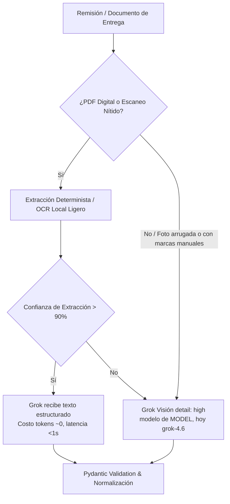

# CotejAI — Propuesta de Mejoras Estratégicas y Técnicas

Documento de optimizaciones, adiciones de arquitectura y ventajas competitivas para el agente **CotejAI** en el marco del torneo *Platica MagIA Tournament (Reto Agente 2026)*.

> ⚠️ **Cifras ilustrativas.** Los porcentajes de ahorro, la tabla del dashboard, el costo por factura, el precio y el margen de este documento son **ejemplos o estimaciones sin medir**. No son resultados de CotejAI. Los números reales salen de la telemetría (`llm_calls`) y de la evaluación de S3 y S4; hasta entonces no se usan en el pitch.
>
> **Dónde quedó cada mejora en los planes:**
> | Mejora | Plan |
> | --- | --- |
> | 1. Extracción por niveles | [S3 · T5](S3-datos-y-costos.md) |
> | 2. Reconciliador de SKUs y unidades | [S2 · T9](S2-herramientas-reales.md) |
> | 3. WAL, backpressure, checkpoints | [S2 · T2](S2-herramientas-reales.md) y [S4 · T2](S4-semana-de-carga.md) |
> | 4. CLI enriquecido y reporte de fugas | [S2 · T10](S2-herramientas-reales.md) y [S3 · T6](S3-datos-y-costos.md) |
> | 5. Servidor MCP y precios | [S4 · después de S4](S4-semana-de-carga.md) y [mercado.md](mercado.md) |

---

## 1. Arquitectura Híbrida de Ingesta Documental (OCR Ligero + Grok Visión)

### Diagnóstico del Problema
Enviar cada remisión física como imagen en alta resolución (`detail: high`) directo a Grok en cada caso introduce tres riesgos en producción:
- Latencia elevada por caso (de 5 a 15 segundos adicionales por llamada multimodal; *estimación, sin medir en el gateway*).
- Consumo acelerado del presupuesto de tokens/créditos.
- Dependencia crítica de la estabilidad del endpoint de visión del gateway (`api.reto.pltk.mx`), que podría saturarse en la prueba de carga.

### Solución Propuesta
Implementar un pipeline de extracción por niveles (*tiered extraction*):



1. **Nivel 1 (OCR Local / Determinista):** Procesamiento rápido con bibliotecas de huella mínima (`pypdf`, `rapidocr` o `pdfplumber`). Si el documento es un PDF vectorial o un escaneo nítido, los datos tabulares se extraen localmente sin llamadas a red.
2. **Nivel 2 (Grok Visión):** Se activa exclusivamente ante remisiones con baja confianza, firmas manuscritas, sellos de almacén o anotaciones al margen (*ej. "se recibieron 8 de 10 por daño"*).

### Impacto en Rúbrica
- **Reducción de costos en S3/S4:** Ahorro estimado del 40% al 60% en tokens de entrada (*ilustrativo: se mide en S3 · T5 antes y después*).
- **Cuidado:** las fotos con tachones y notas a mano, que son el diferencial del proyecto, casi siempre caerán en el Nivel 2. El ahorro real depende de cuántas remisiones lleguen como PDF digital.
- **Velocidad en S4:** Permite procesar lotes grandes sin agotar los límites por minuto (RPM/TPM).

---

## 2. Reconciliador Semántico y Conversor de Unidades de SKUs

### Diagnóstico del Problema
En operaciones reales de compras B2B en México:
- La Orden de Compra registra: `Cinta Canela 48mm x 100m Tuck (Caja con 24 pzas)`.
- El CFDI 4.0 factura la clave del SAT `31201500` con descripción `CT-CAN-TUCK-100` y unidad `Pieza`.
- La remisión de almacén indica: `Cinta adhesiva café - 48 rollos`.

El cotejo determinista tradicional falla al emparejar cadenas exactas, provocando falsos rechazos o escalamientos innecesarios a humanos.

### Solución Propuesta
Añadir una herramienta especializada de reconciliación semántica (`asociar_conceptos_ambiguos`):

```python
class MapeoSKU(BaseModel):
    sku_oc: str
    concepto_cfdi: str
    confianza_similitud: float = Field(ge=0, le=1)
    factor_conversion: Decimal = Field(default=Decimal("1.0"), description="Ej: 1 caja = 24 piezas")
    justificacion: str
```

- Grok analiza los conceptos no emparejados por código exacto y calcula la equivalencia semántica y el factor de escala de unidades.
- Toda equivalencia queda registrada en una memoria caché/base de datos (`sku_aliases`) para que el próximo lote la resuelva de forma determinista sin gastar tokens.
- **Salvaguarda:** un `factor_conversion` mal propuesto (12 en vez de 24) haría pagar el doble o la mitad. Por eso la primera vez que aparece un alias, el caso se escala para que una persona lo confirme; solo los alias confirmados se reutilizan de forma automática.

---

## 3. Resiliencia de Infraestructura y Control de Backpressure (S4)

### Diagnóstico del Problema
La Semana 4 exige procesar **1,000 unidades de trabajo desatendidas durante 12 horas**. Los fallos habituales en este hito son:
- Saturación de conexiones o bloqueos de base de datos (`database is locked` en SQLite estándar).
- Ráfagas de error `429 Too Many Requests` o microcaídas del gateway.
- Fugas de memoria acumuladas en procesos largos de Python.

### Solución Propuesta
1. **Persistencia Concurrente Robusta:**
   - Uso de SQLite configurado en modo WAL (`PRAGMA journal_mode=WAL; PRAGMA busy_timeout=5000;`) o PostgreSQL en contenedor ligero.
2. **Semáforo Dinámico con Backpressure:**
   - Si se detecta un `429` o degradación de latencia, el worker reduce automáticamente su concurrencia (de 4 hilos a 1), aplica un tiempo de enfriamiento exponencial y reanuda progresivamente.
3. **Puntos de Control Idempotentes (Checkpoints):**
   - Cada caso se procesa bajo una máquina de estados transaccional. Si el sistema sufre una interrupción forzada, al reiniciar retoma exactamente desde el último estado sin duplicar notificaciones ni llamadas al SAT.

---

## 4. Experiencia de Demostración: "Dashboard de Fugas Evitadas"

### Diagnóstico del Problema
Los desarrolladores suelen mostrar salidas de terminal en blanco y negro. Para un jurado mixto (técnicos y líderes de negocio de Platica), los números abstractos en logs no transmiten el impacto financiero inmediato.

### Solución Propuesta
1. **CLI Enriquecido en Vivo (`rich`):**
   - Renderizado en consola con tablas tipográficas, barras de progreso y colores por estado (verde para aprobación, ámbar para retención de pago, rojo para alertas 69-B del SAT).
2. **Generador de Reporte Financiero HTML/JSON:**
   - Al finalizar la auditoría de un lote, el agente emite automáticamente un resumen ejecutivo estructurado. **La tabla es un ejemplo del formato; sus valores son inventados:**

| Métrica Clave | Valor de ejemplo (ilustrativo, no medido) |
|---|---|
| **Facturas Auditadas** | 100 casos |
| **Fuga Total Detectada y Retenida** | $142,850.00 MXN |
| **Notas de Crédito Solicitadas** | 18 solicitudes |
| **Alertas Críticas SAT / Lista 69-B** | 1 proveedor bloqueado |
| **Costo Total en Inferencia IA** | $2.38 USD |
| **Multiplicador de Retorno de Inversión (ROI)** | **1,200x** |

Este reporte se convierte en la pieza central del video de 2 minutos de la Semana 2 y del entregable de la Semana 3.

---

## 5. Diseño Preparado para Monetización en Platica.mx (Track 2)

### Diagnóstico del Problema
Los 5 finalistas deberán defender un modelo de negocio con márgenes reales sobre la infraestructura de Platica. Si el proyecto se diseña como un script aislado, adaptarlo a Platica tomará semanas extra.

### Solución Propuesta
Dejar la integración modular desde el inicio mediante dos componentes:

1. **Servidor MCP de CotejAI (`src/api/mcp_server.py`):**
   - Exponer las herramientas principales para que cualquier agente conversacional de Platica pueda invocarlas:
     - `consultar_estado_factura(uuid)`
     - `auditar_lote_compras(fecha_inicio, fecha_fin)`
     - `obtener_expediente_discrepancia(case_id)`
2. **Modelo de Precios Unit Economics (Pitch Deck)** — *hipótesis para validar en Track 2, no cifras medidas:*
   - **Costo operativo de CotejAI:** ~$0.04 USD por factura procesada (*estimación de la guía con tarifas de grok-4.7; el costo real con grok-4.6 sale de `llm_calls` en S3*).
   - **Precio de mercado propuesto:** $0.50 USD (~$9 MXN) por factura auditada o plan mensual de $1,999 MXN por hasta 500 facturas (*hipótesis; validar con clientes*).
   - **Margen bruto:** Superior al **90%** (*se deriva de las dos hipótesis anteriores; debe incluir también el costo de mensajes de WhatsApp vía Platica*), convirtiéndolo en un add-on de alta rentabilidad para el portafolio comercial de Platica.
