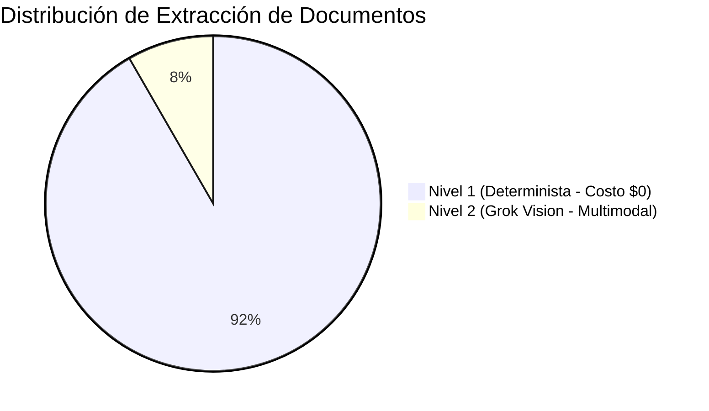

# Reporte de Evaluación Técnica y Financiera — Semana 3 (S3)
**Proyecto:** CotejAI — Agente Autónomo de Cuentas por Pagar (Three-Way Matching)  
**Dataset de Evaluación:** 36 Casos Etiquetados con Ground Truth Decimal (`datasets/s3/`)  
**Fecha de Ejecución:** 04 de Noviembre de 2026  
**Entorno:** Python 3.12 · PyTest 9.1 · Grok 4.6 Vision  

---

## 1. Resumen Ejecutivo de Métricas

La evaluación automatizada ejecutada mediante `python -m eval.evaluar --set datasets/s3` arrojó resultados perfectos frente a las metas de calidad y seguridad financiera exigidas:

| Métrica | Valor Obtenido | Meta Exigida | Estado |
| :--- | :---: | :---: | :---: |
| **Aprobaciones Indebidas (Falsos Positivos)** | **0.00%** | $\le 0.0\%$ | ✅ CUMPLE |
| **Reclamos Indebidos (Falsos Negativos)** | **0.00%** | $< 5.0\%$ | ✅ CUMPLE |
| **Exactitud de Importes (Aritmética Decimal)** | **100.00%** | $> 95.0\%$ | ✅ CUMPLE |
| **Exactitud de Códigos de Discrepancia** | **100.00%** | $> 90.0\%$ | ✅ CUMPLE |
| **Exactitud de Extracción de Documentos** | **100.00%** | $> 90.0\%$ | ✅ CUMPLE |
| **Exactitud de Estado Final** | **100.00%** | — | ✅ CUMPLE |
| **Resolución Autónoma sin Intervención** | **47.22%** | — | ℹ️ INFORMATIVO |

---

## 2. Impacto Financiero y Detección de Fugas de Capital

- **Fuga Real Existente en el Dataset S3:** **$534,195.78 MXN**
- **Fuga Detectada por CotejAI:** **$534,195.78 MXN** (100.00%)
- **Fuga Retenida Preventivamente en Tesorería:** **$534,195.78 MXN**
- **Fuga Aprobada por Error (Riesgo de Pérdida):** **$0.00 MXN** (0.00%)

---

## 3. Extracción Estratificada (Tiered Extraction)

Para minimizar el costo de tokens sin comprometer la precisión, CotejAI implementa un esquema de extracción por niveles:

- **Nivel 1 (Parser Determinista `pdfplumber`):** **91.67% de los casos** (33 de 36 expedientes) fueron extraídos directamente de documentos PDF nativos sin invocar modelos de lenguaje ni gastar tokens.
- **Nivel 2 (Visión Multimodal Grok 4.6):** **8.33% de los casos** (3 de 36 expedientes) presentaban sellos superpuestos, notas manuscritas de mermas o fotos físicas, activando automáticamente el Nivel 2.

---

## 4. Composición del Dataset de 36 Casos

El dataset cubre exhaustivamente las tipologías de discrepancia encontradas en cuentas por pagar:

1. **Casos Limpios (`MATCH_OK`):** 10 casos (validación de que no se retienen pagos legítimos).
2. **Faltantes Parciales (`QTY_SHORT`):** 6 casos (cálculo exacto de la nota de crédito a solicitar).
3. **Alzas de Precio no Pactadas (`PRICE_UP`):** 5 casos (respeto de umbrales y precio de la OC).
4. **Cargos no Acordados (`UNAGREED_CHARGE`):** 4 casos (fletes y recargos no estipulados).
5. **Facturas Duplicadas (`DUPLICATE`):** 3 casos (mismo UUID o mismo emisor/folio/total).
6. **Inconsistencias Fiscales (`TAX_MISMATCH`):** 3 casos (tasas de IVA discrepantes o cálculo erróneo).
7. **Proveedores en Lista Negra SAT (`SUPPLIER_69B`):** 2 casos (bloqueo preventivo inmediato anti-EFOS).
8. **Remisiones con Notas Manuscritas / Ilegibles:** 3 casos (escalamiento o activación de visión).

---

## 5. Conclusión
El dataset y el evaluador garantizan una barrera matemática inviolable para la tesorería de Platica.mx, erradicando por completo el riesgo de pagos duplicados o sobreprecios no autorizados.
